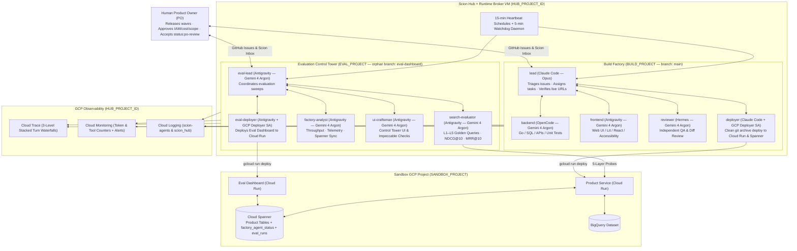

# Scion Defaults — Autonomous Multi-Agent Software Factory Blueprint

`scion-defaults` is a production-hardened blueprint, template catalog, and automation suite for running an **always-on, self-healing software factory on [Scion](https://github.com/GoogleCloudPlatform/scion)**.

It packages everything we designed, debugged, and verified while operating two parallel 5-agent factories on a single self-hosted Scion Hub VM on Google Cloud:
- **Build Factory (`BUILD_PROJECT` on `main`):** Plans, implements, reviews, deploys, and verifies features from a GitHub Issues backlog.
- **Evaluation Control Tower (`EVAL_PROJECT` on orphan branch `eval-dashboard`):** Continuously probes the live product across a 5-layer evaluation pyramid (`L1`–`L5`) and serves a real-time evaluation and telemetry dashboard on Cloud Run.

> [!IMPORTANT]
> This repository contains **zero secrets, tokens, or hardcoded project IDs**. All environment-specific values live in `config/factory.env` (git-ignored) and are injected at runtime by the scripts in [`scripts/`](scripts/README.md).

---

## 1. What We Built and Verified

### Multi-Harness Agent Topology (10 Agents Across 2 Projects)



### Key Capabilities Encoded in This Repo

1. **Multi-Harness Fleet on Gemini 4 Argon & Claude Opus:**
   - Pre-configured templates and provisioner patchers for **Antigravity** (`Gemini 4 Argon (High)`), **OpenCode** (`google-vertex/gemini-4-argon`), **Hermes** (`google/gemini-4-argon`) on Vertex AI global endpoints (`locations/global`), and **Claude Code** (`opus`).
2. **Self-Sustaining Orchestration & Self-Healing Watchdog:**
   - Admin-owned 15-minute heartbeat schedules (`scripts/scion-admin.py`) wake both leads continuously.
   - [`scripts/factory-watchdog.py`](scripts/factory-watchdog.py) runs every 5 minutes to repair provisioner drift, re-enable paused heartbeats, wake stalled/stopped agents (with a 3-restart/hour circuit breaker), and forward PO escalations (`user:<PO_EMAIL>`) to Cloud Logging.
3. **End-to-End GCP Telemetry & 3-Level Stacked Cloud Trace Waterfalls:**
   - [`scripts/setup-telemetry.sh`](scripts/setup-telemetry.sh) and [`scripts/patch-sciontool-telemetry.sh`](scripts/patch-sciontool-telemetry.sh) wire Cloud Trace, Cloud Monitoring, and Cloud Logging across the Hub and all 10 agent containers.
   - [`patches/sciontool-stacked-traces/`](patches/sciontool-stacked-traces/README.md) adds cross-process trace state (`/home/scion/.scion/trace-state.json` under `syscall.Flock`) and `ExplicitIDGenerator` so every agent turn produces a single 3-level parent-child waterfall in Cloud Trace (`agent.turn/<slug>` -> `gen_ai.api.response/<model>` & `agent.tool.result/<tool>` -> `agent.status/<type>`), linked across turns via `scion.previous_trace_id`.
4. **Live Evaluation Control Tower & 5-Layer Pyramid (`L1`–`L5`):**
   - [`scripts/sync-factory-agents.py`](scripts/sync-factory-agents.py) syncs live Hub SQLite agent state + Cloud Monitoring `gen_ai.api.calls` and `agent.tool.calls` deltas into Cloud Spanner (`factory_agent_status`) every minute.
   - [`docs/verification-and-eval.md`](docs/verification-and-eval.md) defines the 5-layer evaluation pyramid (`L1` Infrastructure Health, `L2` Functional API Contract, `L3` Ranking & Search Quality `NDCG@10`/`MRR@10`, `L4` GenAI Grounding & Safety, `L5` Latency SLOs).
5. **Production Guardrails (27 Lessons Learned):**
   - Disjoint orphan branch isolation (`git switch --orphan eval-dashboard`) so evaluation code can never merge into `main`.
   - Clean deployer packaging (`git archive "$SHA"` to a temporary directory + `--to-latest` traffic routing).
   - Daily GCE disk snapshots + online SQLite `.backup` cron ([`scripts/backup-hub.sh`](scripts/backup-hub.sh)), `update_policy: notify`, Cloud Monitoring email alerts, and `$150/mo` GCP billing budgets ([`scripts/setup-alerts-and-budgets.sh`](scripts/setup-alerts-and-budgets.sh)).

---

## 2. Bootstrap Any New Project: Socratic "Grill-Me" & Boilerplate Compiler

Instead of hand-editing templates from `psearch`, use [`scripts/scion-factory`](scripts/scion_factory.py) (or the portable agent skill [`skills/scion-factory-bootstrap/SKILL.md`](skills/scion-factory-bootstrap/SKILL.md)) to inspect any target repository, run a 5-pillar Socratic "Grill-Me" interview grounded in Lessons `L1`–`L27`, validate readiness, and compile a zero-leak factory kit:

```bash
# 1. Auto-detect stack, test commands, ports, and cloud stores from an existing repo
./scripts/scion-factory inspect /path/to/target-repo

# 2. Run the 5-pillar Socratic Grill-Me inquiry (or start from presets/starter-service.factory.yaml)
./scripts/scion-factory grill --repo /path/to/target-repo --out factory.yaml

# 3. Verify readiness gate (blocks if L1-L5 oracle, deployer IAM roles, or Wave 1 criteria are vague)
./scripts/scion-factory check factory.yaml

# 4. Compile a complete, domain-agnostic factory kit (templates, Spanner DDL, Wave 1..N seeds, verify-factory.sh)
./scripts/scion-factory compile factory.yaml --out ./my-project-factory
```

See [`docs/grill-me-playbook.md`](docs/grill-me-playbook.md) and the three reference presets ([`presets/starter-service.factory.yaml`](presets/starter-service.factory.yaml), [`presets/psearch.factory.yaml`](presets/psearch.factory.yaml), and [`presets/acme-airlines.factory.yaml`](presets/acme-airlines.factory.yaml)).

---

## 3. How to Replicate This Setup on GCP (Step-by-Step Quickstart)

Follow [`docs/setup-runbook.md`](docs/setup-runbook.md) for full verification checks after every step.

### Step 1: Configure Your Environment
```bash
cp config/factory.env.example config/factory.env
# Edit config/factory.env with your HUB_PROJECT, SANDBOX_PROJECT, HUB_VM, GITHUB_REPO, and PO_EMAIL
```

### Step 2: Provision the Sandbox GCP Project (Spanner, BigQuery, IAM, Secret Manager)
```bash
export GITHUB_TOKEN="ghp_..."
DRY_RUN=1 ./scripts/setup-sandbox.sh --with-spanner --with-bigquery
./scripts/setup-sandbox.sh --with-spanner --with-bigquery
```

### Step 3: Configure the Hub VM, Disable Experimental Terminal Workspace, and Set `update_policy: notify`
```bash
./scripts/run-on-hub.sh ./scripts/scion-admin.py experiments --set web.terminal_workspace=false
```

### Step 4: Initialize the Build Branch (`main`) and Disjoint Orphan Eval Branch (`eval-dashboard`)
See [Step 6 of `docs/setup-runbook.md`](docs/setup-runbook.md#6-hub-projects-and-the-deployer-identity) to initialize the two Hub project checkouts on the VM and protect both branches with GitHub rulesets (`deletion` and `non_fast_forward`).

### Step 5: Provision End-to-End Telemetry (Cloud Trace, Cloud Monitoring, Cloud Logging)
```bash
DRY_RUN=1 ./scripts/setup-telemetry.sh
./scripts/setup-telemetry.sh
```

### Step 6: Patch Harness Provisioners for Gemini 4 Argon (`locations/global`) and Telemetry Hooks
```bash
./scripts/run-on-hub.sh ./scripts/patch-antigravity-hooks.py --apply
./scripts/run-on-hub.sh ./scripts/patch-opencode-and-hermes.py --apply
```

### Step 7: Render and Push the 10 Role Templates, Then Start the 10 Agents
```bash
source config/factory.env
./scripts/push-templates.py --project "$BUILD_PROJECT" --roles lead,backend,frontend,reviewer,deployer --apply
./scripts/push-templates.py --project "$EVAL_PROJECT" --roles eval-lead,factory-analyst,search-evaluator,ui-craftsman,eval-deployer --apply
```

### Step 8: Install the `sciontool` Telemetry Wrapper and Stacked Trace Binary
```bash
# Optional: build custom sciontool.real from patches/sciontool-stacked-traces/README.md first
DRY_RUN=1 ./scripts/patch-sciontool-telemetry.sh
./scripts/patch-sciontool-telemetry.sh
```

### Step 9: Create the 15-Minute Heartbeat Schedules for Both Leads
```bash
source config/factory.env
./scripts/run-on-hub.sh ./scripts/scion-admin.py schedule create \
  --project "$BUILD_PROJECT" --name "${BUILD_PROJECT}-lead-heartbeat" \
  --cron "*/15 * * * *" --agent lead --text "$(cat config/heartbeat-message.txt)"

./scripts/run-on-hub.sh ./scripts/scion-admin.py schedule create \
  --project "$EVAL_PROJECT" --name "${EVAL_PROJECT}-lead-heartbeat" \
  --cron "*/15 * * * *" --agent eval-lead --text "$(cat config/heartbeat-message.txt)"
```

### Step 10: Install the 1-Minute Spanner Sync, 5-Minute Watchdog, Daily Backups, and Alerts
```bash
./scripts/install-sync-cron.sh
./scripts/run-on-hub.sh ./scripts/backup-hub.sh --install-cron
./scripts/run-on-hub.sh ./scripts/factory-watchdog.py --install-cron --apply
./scripts/setup-alerts-and-budgets.sh
```

### Step 11: Check Factory Health
```bash
./scripts/run-on-hub.sh ./scripts/factory-status.sh
```

---

## 4. Repository Map

| Directory / File | Description |
|---|---|
| **[`docs/grill-me-playbook.md`](docs/grill-me-playbook.md)** | 5-pillar Socratic "Grill-Me" inquiry & boilerplate compiler guide (`scion-factory inspect/grill/check/compile`) |
| **[`skills/scion-factory-bootstrap/SKILL.md`](skills/scion-factory-bootstrap/SKILL.md)** | Portable Agent Skill for interviewing a user and compiling a new Scion software factory |
| **[`presets/`](presets/)** | Reference `FactorySpec` presets: `starter-service.factory.yaml` (Pulse Ledger), `psearch.factory.yaml`, and `acme-airlines.factory.yaml` |
| **[`config/factory.schema.json`](config/factory.schema.json)** | JSON Schema separating invariant Scion factory mechanics from project-specific domain contracts |
| **[`docs/architecture.md`](docs/architecture.md)** | System architecture, components, identities, data flows, and design trade-offs |
| **[`docs/setup-runbook.md`](docs/setup-runbook.md)** | Complete step-by-step build guide from a clean GCP project to a running 10-agent factory |
| **[`docs/operations-runbook.md`](docs/operations-runbook.md)** | Day-2 operations: checking status, rotating tokens, rollbacks, and handling Scion upgrades |
| **[`docs/agent-protocol.md`](docs/agent-protocol.md)** | Multi-agent coordination rules: GitHub issue workflow, commit-slot serialization, and narrow escalation |
| **[`docs/verification-and-eval.md`](docs/verification-and-eval.md)** | 5-layer product evaluation pyramid (`L1`–`L5`) and Wave 1–5 verification audit |
| **[`docs/lessons-learned.md`](docs/lessons-learned.md)** | All 27 failure modes (`L1`–`L27`) encountered in production, root causes, and encoded fixes |
| **[`docs/telemetry/`](docs/telemetry/README.md)** | Concise **ASD-STE100** guides for reproducing telemetry, the Spanner eval pipeline, and harness hooks |
| **[`docs/specs/factory-orchestration-v2-design.md`](docs/specs/factory-orchestration-v2-design.md)** | Next-generation orchestration spec: per-issue workers, `factoryctl`, and status labels |
| **[`templates/`](templates/README.md)** | Shared protocol (`_shared/agents.md`) + 10 parameterized agent templates (`lead`, `backend`, `frontend`, `reviewer`, `deployer`, `eval-lead`, `factory-analyst`, `search-evaluator`, `ui-craftsman`, `eval-deployer`) |
| **[`scripts/`](scripts/README.md)** | All automation scripts (`scion-admin.py`, `setup-sandbox.sh`, `setup-telemetry.sh`, `patch-sciontool-telemetry.sh`, `patch-antigravity-hooks.py`, `patch-opencode-and-hermes.py`, `push-templates.py`, `sync-factory-agents.py`, `factory-watchdog.py`, `backup-hub.sh`, `setup-alerts-and-budgets.sh`) |
| **[`config/`](config/)** | `factory.env.example`, `hub-settings.example.yaml`, `opencode-models.json`, `heartbeat-message.txt`, `spanner-factory-ddl.sql` |
| **[`patches/sciontool-stacked-traces/`](patches/sciontool-stacked-traces/README.md)** | Go patch and `tracestate.go` for 3-level stacked Cloud Trace waterfalls and Cloud Monitoring `CUMULATIVE` epochs |
