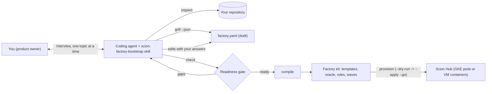

# Scion defaults

`scion-defaults` bootstraps an always-on, self-healing multi-agent software factory on [Scion](https://github.com/GoogleCloudPlatform/scion). You pair with an agentic coding assistant such as Antigravity, Claude Code, OpenCode, or Codex. The coding agent inspects your repository, conducts a structured interview, and compiles a complete factory kit. You can then provision a new or existing Scion Hub on Google Kubernetes Engine (GKE) or a Compute Engine VM.

A compiled factory kit includes:

- Role templates for a build team and an independent evaluation team.
- A structured knowledge plane with automated link and requirement checks.
- A five-layer evaluation oracle and golden-dataset workspace.
- A serverless Firestore control plane for agent status, evaluation runs, and watchdog state.
- A seeded multi-wave issue backlog. Git is optional; you can start without Git and enable it later.

Every default and interview question traces to production runs documented in [`docs/lessons-learned.md`](docs/lessons-learned.md) (lessons L1–L33). Those runs include a 10-agent hybrid search factory, a 14-agent airline-operations factory, a Kubernetes monorepo factory, and a 30-issue overnight run. This document follows the Google Developer Documentation Style Guide and the **ASD-STE100** Simplified Technical English standard.

> [!IMPORTANT]
> Always run this toolkit through an agentic coding assistant. The CLI scripts do not interview you or make architecture decisions. Your coding agent conducts the interview, while the scripts inspect, validate, compile, and provision deterministically.

## Document map

| Goal | Section | Mode |
|---|---|---|
| Paste a prompt into your coding agent | [Starting prompts](#starting-prompts) | Quickstart |
| Provision a compiled kit with one command | [Provision a compiled kit automatically](#provision-a-compiled-kit-automatically) | How-to |
| Understand the architecture and topologies | [How it works](#how-it-works) | Explanation |
| Deploy a Hub and factory step by step | [Set up a factory end to end](#set-up-a-factory-end-to-end) | Tutorial |
| Prepare answers for the Socratic interview | [Review the interview topics](#review-the-interview-topics) | Reference |
| Inspect compiled artifacts and knowledge files | [Review the generated factory kit](#review-the-generated-factory-kit) and [Understand the knowledge plane](#understand-the-knowledge-plane) | Reference |
| Operate without Git, add Git later, or split a monorepo | [Choose whether to use Git](#choose-whether-to-use-git), [Add Git later](#add-git-later), and [Run several factories in one monorepo](#run-several-factories-in-one-monorepo) | How-to |
| Explore the reference topology and repository files | [Reference architecture](#reference-architecture) and [Repository layout](#repository-layout) | Reference |

## How it works

The workflow separates judgment tasks from repeatable automation. Your coding agent handles judgment, while deterministic Python and Bash tools execute repeatable steps.

| Component | Purpose | Type |
|---|---|---|
| [`skills/scion-factory-bootstrap/SKILL.md`](skills/scion-factory-bootstrap/SKILL.md) | Guides your coding agent to inspect your repository, ask one topic at a time, and challenge vague answers using lessons L1–L33. | Agentic skill |
| [`scripts/scion-factory`](scripts/scion_factory.py) | Detects repository facts, writes a draft `factory.yaml`, checks readiness, adds specialist roles (`add-role`), compiles the kit, enables Git (`enable-git`), and runs `provision`. It makes zero LLM calls and never blocks on interactive input. | Deterministic CLI |
| [`scripts/provision_factory.py`](scripts/provision_factory.py) and [`scripts/hub_client.py`](scripts/hub_client.py) | Provision projects, Workload Identity, shared directories, templates, schedules, and leads over the Hub HTTPS API. Supports IAP OIDC and local SQLite fallback. | Transport-agnostic control |
| [`scripts/setup-gke-hub.sh`](scripts/setup-gke-hub.sh) and [`scripts/install-k8s-control-plane.py`](scripts/install-k8s-control-plane.py) | Bootstrap a GKE-backed Scion Hub and install Kubernetes `CronJob` loops for Firestore sync and self-healing watchdog checks. | Infrastructure automation |
| Generated factory kit | A multi-agent build and evaluation system that runs on GKE pods or Docker containers. | Multi-agent system |



### Supported execution topologies

You can run a Scion software factory on three topologies:

1. **Full GKE Multi-Hub HA:** Scion Hub runs on Cloud Run or GKE with Cloud SQL and Filestore, and agents run as pods on GKE Autopilot. See [`docs/gke-setup-runbook.md`](docs/gke-setup-runbook.md).
2. **Hybrid VM + GKE (`gke_target`):** A single-VM Scion Hub dispatches agent pods to an attached GKE cluster through a `gke` runtime profile.
3. **Single-VM Docker fallback:** A standalone Compute Engine VM runs both the Scion Hub and Docker agent containers. See [`docs/setup-runbook.md`](docs/setup-runbook.md).

Across all three topologies, the factory control plane stores agent status, evaluation runs, and watchdog state in serverless Firestore. You do not size or pay for an idle control-plane database. Product services deploy to Cloud Run by default. During the interview, the agent steers product data toward serverless stores and asks you to justify provisioned databases such as Spanner, AlloyDB, or Cloud SQL.

### Static facts versus product intent

The bootstrap tools separate repository facts from human intent:

- **Static facts** exist in your repository today. Examples include programming languages, build and test commands, exposed ports, cloud SDK imports, existing ADRs, API contracts, and the GitHub remote. The tool detects static facts automatically so you only confirm them.
- **Product intent** comes only from you. Examples include the mission, non-goals, Git mode, runtime topology, deployer IAM roles, quality metrics, latency targets, and initial backlog waves. The draft `factory.yaml` leaves intent fields empty so the readiness gate fails until you supply testable answers.

## Starting prompts

Open your coding agent inside a clone of this repository and paste one of the prompts below. Replace uppercase placeholders such as `OWNER/REPO`, `PROJECT_ID`, `HUB_URL`, `HUB_VM`, `HUB_ZONE`, `ORGANIZATION_ID`, `BILLING_ACCOUNT_ID`, `ADMIN_EMAIL`, `TARGET_REPO_PATH`, `PATH_1`, and `PATH_2` with your values.

### Add a factory to an existing Scion Hub (Existing GKE Scion Hub or Single-VM Hub)

Use this prompt when a Scion Hub already runs in Google Cloud. The agent inspects your repository, interviews you, compiles the kit, and launches the factory on `factory/main` and `factory/eval` without modifying `main`:

```none
Use the scion-factory-bootstrap skill and README.md to set up a Scion software factory for https://github.com/OWNER/REPO on my existing Scion Hub:
- Hub project: PROJECT_ID (GKE Hub URL: HUB_URL, or VM: HUB_VM in zone HUB_ZONE; PO admin: ADMIN_EMAIL)
- Keep the default branch untouched: use build branch factory/main and orphan eval branch factory/eval.
Clone or inspect the repository first, propose specialist roles from what you find in the codebase, interview me one topic at a time, compile the kit, and deploy and start the factory on the Hub.
```

### Create a new Scion Hub and launch a factory end to end (Full GKE Scion installation + auto-factory)

Use this prompt when you do not have a Scion Hub yet. The agent provisions the Google Cloud project and GKE (or VM) Scion Hub, runs the interview, compiles the kit, and starts the factory:

```none
Use the scion-factory-bootstrap skill and README.md to create a new Scion Hub and launch a software factory for https://github.com/OWNER/REPO:
- New Hub project: PROJECT_ID (organization: ORGANIZATION_ID, billing account: BILLING_ACCOUNT_ID, PO admin: ADMIN_EMAIL)
- Runtime topology: Full GKE Multi-Hub HA (setup-gke-hub.sh) with agents running on GKE pods.
- Build branch: factory/main, orphan eval branch: factory/eval.
Inspect the repository, interview me to fill in factory.yaml, compile the kit, provision the GKE Hub and sandbox, and start the build and evaluation leads.
```

### Interview and compile a kit locally (service or `deploy: none` library)

Use this prompt when you only want to run the interview and compile the kit on local disk. This path also supports Go, Python, or TypeScript libraries and CLIs that set `infrastructure.deploy: none`:

```none
Bootstrap a Scion software factory for TARGET_REPO_PATH using the scion-factory-bootstrap skill. Inspect the codebase, propose specialist roles from repository signals, interview me one topic at a time, and compile the validated kit into ../my-factory-kit.
```

### Split a monorepo into multiple factories

Use this prompt when one repository contains multiple packages or services. Each factory scopes work by `monorepo.subdir` (`FACTORY_SUBDIR`), `AGENT_PREFIX`, and `factory:<slug>` issue labels:

```none
Use the scion-factory-bootstrap skill to set up Scion factories for the monorepo at https://github.com/OWNER/REPO on my existing Scion Hub (project: PROJECT_ID, GKE Hub URL: HUB_URL or VM: HUB_VM in zone HUB_ZONE, PO admin: ADMIN_EMAIL):
- Subfolders to turn into factories: PATH_1, PATH_2
- Keep main untouched: share build branch factory/main and orphan eval branch factory/eval across the factories, with per-factory AGENT_PREFIX and factory:<slug> issue labels.
Inspect each subfolder, interview me, compile one kit per factory, and deploy them to the Hub.
```

## Provision a compiled kit automatically

After you validate `factory.yaml`, compile a kit, and populate `config/FACTORY_SLUG.env`, run the nine-phase provisioner in dry-run mode first:

```bash
./scripts/scion-factory provision factory.yaml \
  --kit OUTPUT_DIR \
  --env config/FACTORY_SLUG.env \
  --seed-repo TARGET_REPO_PATH
```

Review the planned actions across preflight, sandbox IAM, repository seeding, Hub projects, Workload Identity settings, shared directories, templates, control-plane jobs, and schedules. Then execute the plan and send the initial `GO` brief:

```bash
./scripts/scion-factory provision factory.yaml \
  --kit OUTPUT_DIR \
  --env config/FACTORY_SLUG.env \
  --seed-repo TARGET_REPO_PATH \
  --apply \
  --go
```

## Set up a factory end to end

This tutorial walks you from a Google Cloud project to a live software factory. Choose your deployment path:

| Deployment path | When to choose it | Procedure |
|---|---|---|
| **New Full GKE Scion Hub** | Production or multi-factory GKE pod isolation with Cloud Run/GKE Hub, Cloud SQL, Filestore, and GKE Autopilot. | Step 1, Step 2 (Option A), then [Provision a compiled kit automatically](#provision-a-compiled-kit-automatically) or Steps 3 to 8. Full details live in [`docs/gke-setup-runbook.md`](docs/gke-setup-runbook.md). |
| **New Single-VM Scion Hub** | Trial setup on one Compute Engine VM (~2 hours including initial image builds). | Steps 1 to 8. |
| **Existing GKE or Single-VM Hub** | A Scion Hub already runs in Google Cloud (~1 hour). | [Use an existing Scion Hub](#use-an-existing-scion-hub), then Steps 3 to 8 (or `scion-factory provision`). |

For a quick trial, this tutorial reuses one Google Cloud project for both the Hub and the sandbox. For production, create a separate sandbox project so agent workloads remain isolated from the Hub, as documented in [`docs/setup-runbook.md`](docs/setup-runbook.md). Steps 5 and 6 assume you enable Git in the interview; without Git, follow [Choose whether to use Git](#choose-whether-to-use-git) and step 6 of [`docs/setup-runbook.md`](docs/setup-runbook.md).

### Before you begin

1. Verify that you have the required accounts, permissions, and local tools:

   - **New Hub:** A Google Cloud organization, a billing account, and permission to create projects.
   - **Existing GKE Hub:** HTTPS access to `HUB_URL` (with IAP access when IAP is enabled) and a Hub admin account (`ADMIN_EMAIL`). Also verify `kubectl` cluster access to install control-plane `CronJob`s.
   - **Existing Single-VM Hub:** IAP SSH access to the Hub VM (such as `Compute OS Admin Login` and `IAP-secured Tunnel User`) and a Hub admin account (`ADMIN_EMAIL`).
   - **GitHub:** A target product repository and a personal access token (PAT) with read/write access to contents, issues, and pull requests. Every agent acts as the token owner.
   - **Local CLI tools:** `gcloud` (with `beta`), `gh`, `git` 2.42+, `jq`, `openssl`, `python3`, and [`uv`](https://docs.astral.sh/uv/). Install `terraform` and `kubectl` when deploying a GKE Hub. You do not need Docker locally.
   - **Coding agent:** An assistant that supports skills, such as Antigravity or Claude Code.

2. Clone this repository and link the bootstrap skill into your coding agent. For Antigravity:

   ```bash
   git clone https://github.com/duboc/scion-defaults.git
   ln -s "$PWD/scion-defaults/skills/scion-factory-bootstrap" ~/.gemini/config/skills/scion-factory-bootstrap
   ```

   For Claude Code, link the same directory into `~/.claude/skills/`. For other agents, pass [`skills/scion-factory-bootstrap/SKILL.md`](skills/scion-factory-bootstrap/SKILL.md) directly.

3. Export the base environment variables for the tutorial. Replace each uppercase placeholder:

   ```bash
   export HUB_PROJECT_ID=PROJECT_ID               # New Hub: unique project ID; existing Hub: current project ID
   export ADMIN_EMAIL=ADMIN_EMAIL                 # Google account that acts as Hub admin and product owner
   export ORGANIZATION_ID=ORGANIZATION_ID         # Required for a new project only
   export BILLING_ACCOUNT_ID=BILLING_ACCOUNT_ID   # Required for a new project only
   ```

### Step 1: Create a Google Cloud project for the Hub

Create the project, attach billing, enable base APIs, and ensure the `default` VPC network exists:

```bash
gcloud projects create "$HUB_PROJECT_ID" --organization="$ORGANIZATION_ID"
gcloud billing projects link "$HUB_PROJECT_ID" --billing-account="$BILLING_ACCOUNT_ID"
gcloud services enable compute.googleapis.com cloudresourcemanager.googleapis.com --project="$HUB_PROJECT_ID"
gcloud compute networks describe default --project="$HUB_PROJECT_ID" >/dev/null 2>&1 \
  || gcloud compute networks create default --project="$HUB_PROJECT_ID" --subnet-mode=auto
```

Some organizations disable automatic `default` network creation. The final command creates `default` only when it is missing.

### Step 2: Deploy the Scion Hub

Choose **Option A (GKE)** or **Option B (Single-VM)**.

#### Option A: Deploy a Full GKE or Hybrid GKE Scion Hub

1. Clone upstream Scion and run [`scripts/setup-gke-hub.sh`](scripts/setup-gke-hub.sh) in dry-run/plan mode first:

   ```bash
   git clone https://github.com/GoogleCloudPlatform/scion.git
   HUB_PROJECT="$HUB_PROJECT_ID" HUB_REGION="us-central1" HUB_NAME="prod" PO_EMAIL="$ADMIN_EMAIL" \
     bash scripts/setup-gke-hub.sh --tier terraform-ha --scion-repo ./scion --harnesses claude,antigravity --dry-run
   ```

2. Review the Cloud Build multi-arch image plan and the Terraform `shared-infra` and `hub` plans. Then run the same command without `--dry-run` to generate `.tfvars` and inspect `terraform plan`, followed by `--approve-apply` to apply infrastructure. See [`docs/gke-setup-runbook.md`](docs/gke-setup-runbook.md) for Hybrid GKE (`--tier hybrid-gke`), IAP configuration, and Vertex AI Model Garden enablement.

3. Sign in to the Hub URL in your browser as `ADMIN_EMAIL` and run `scion hub auth login` (or store `SCION_HUB_TOKEN`) so API tools authenticate as the admin user.

#### Option B: Deploy a Single-VM Scion Hub

1. Clone Scion at the tested release tag and write `hub-config.json`. Keep the installer and Hub binary on the same release:

   ```bash
   export SCION_VERSION=nightly-20261022
   git clone --depth 1 --branch "$SCION_VERSION" https://github.com/GoogleCloudPlatform/scion.git
   cat > hub-config.json <<EOF
   {"hub_name": "factory", "project_id": "$HUB_PROJECT_ID", "region": "us-central1",
    "machine_size": "small", "disk_size_gb": 200, "chat_plugins": [],
    "container_images": {"source": "build", "registry": "", "force_rebuild": false},
    "admin_email": "$ADMIN_EMAIL", "hub_sa_minting": false,
    "update_policy": "notify", "release_channel": "nightly"}
   EOF
   ```

2. Run the single-node VM installer to create `scion-hub-factory`, the IAP-protected Cloud Run proxy, and base images:

   ```bash
   (cd scion/scripts/single-node-vm && ./deploy.sh --version "$SCION_VERSION" --config "$PWD/../../../hub-config.json" < /dev/null)
   ```

   > [!NOTE]
   > Omitting `--version` selects the newest nightly. Avoid `nightly-20261023` on fresh VM installs. That build rejects its initial `http://localhost:8080` base URL before IAP setup completes, so the health check fails.

   When deployment finishes, the script prints `=== Deployment Complete ===`, the VM zone, and the `Access URL`. Rerun the exact command if deployment stops on a transient IAP SSH `502 Bad Gateway` or IAM propagation delay. The installer uses the first zone of the configured region. If that zone reports `ZONE_RESOURCE_POOL_EXHAUSTED`, set another `region` in `hub-config.json` and rerun `deploy.sh`. Next, update the proxy firewall subnet range so the `Access URL` does not return `Bad Gateway`:

   ```bash
   gcloud compute firewall-rules update scion-hub-factory-allow-proxy --project="$HUB_PROJECT_ID" \
     --source-ranges="$(gcloud compute networks subnets describe default --region=NEW_REGION \
       --project="$HUB_PROJECT_ID" --format='value(ipCidrRange)')"
   ```

3. Open the `Access URL` in your browser and sign in as `ADMIN_EMAIL`. First sign-in creates the Hub admin user record.

4. Build the extra harness images on the VM. The VM installer builds only the Antigravity image, while the default roster also uses Claude Code. Add `opencode` or `hermes` to the loop when needed, and replace `HUB_ZONE` with your VM zone:

   ```bash
   gcloud compute ssh scion-hub-factory --project="$HUB_PROJECT_ID" --zone=HUB_ZONE --tunnel-through-iap \
     --command='sudo -u scion bash -c "cd /opt/scion-source && for h in claude; do docker build -q -t scion-\$h:latest --build-arg BASE_IMAGE=scion-base:latest -f harnesses/\$h/Dockerfile harnesses/\$h/ && docker tag scion-\$h:latest localhost/scion/scion-\$h:latest; done"'
   ```

   Claude Code and Antigravity run on a stock Hub. Apply step 7 of [`docs/setup-runbook.md`](docs/setup-runbook.md) before running OpenCode or Hermes. Without those patches, OpenCode blocks on a permission prompt and Hermes crashes at start on `nightly-20261022`.

5. Open Vertex AI Model Garden in `HUB_PROJECT_ID` and enable the Claude models for `lead` and `deployer`. Without Model Garden access, Claude Code starts on the Hub but cannot respond.

### Use an existing Scion Hub

Skip Steps 1 and 2 when a Scion Hub already runs in `HUB_PROJECT_ID`. Your new factory adds two isolated Hub projects without modifying existing factories.

1. Locate your Hub connection details:

   - **Existing GKE or Cloud Run Hub:** Record `HUB_URL`, `HUB_K8S_NAMESPACE`, `IMAGE_REGISTRY`, and optional `HUB_IAP_AUDIENCE`. Authenticate with `scion hub auth login` or export `SCION_HUB_TOKEN`.
   - **Existing Single-VM Hub:** List the Hub VM name (`scion-hub-HUB_NAME`) and zone (`HUB_OS_USER` defaults to `scion`):

     ```bash
     gcloud compute instances list --project="$HUB_PROJECT_ID" --filter="name~^scion-hub" \
       --format="table(name,zone.basename(),status)"
     ```

2. Open the Hub web UI and sign in as `ADMIN_EMAIL` (listed in `admin_emails`). First sign-in creates the Hub admin user record.
3. Choose your `SANDBOX_PROJECT` (either `HUB_PROJECT_ID` for trials or a dedicated sandbox project for production).
4. Continue to Step 3. In Step 4, `hub-preflight.py` verifies Hub health, your admin identity, harness images, existing projects, and active watchdog/sync project lists.

### Step 3: Design the agents from your repository

1. Start your coding agent in `scion-defaults` and run the bootstrap prompt against a local clone of your target repository:

   ```none
   Bootstrap a Scion software factory for TARGET_REPO_PATH using the scion-factory-bootstrap skill.
   ```

2. Confirm the static facts detected from your repository (languages, build/test commands, ports, cloud SDKs, ADRs, and GitHub remote).
3. Complete the structured interview one topic at a time (see [Review the interview topics](#review-the-interview-topics)). The agent rejects untestable answers until `check` passes.
4. Set `OUTPUT_DIR`, compile the generated factory kit, and verify it:

   ```bash
   export OUTPUT_DIR="$PWD/../my-factory-kit"
   ./scripts/scion-factory compile factory.yaml --out "$OUTPUT_DIR"
   "$OUTPUT_DIR/scripts/verify-factory.sh"
   ```

   Compilation prints `Compiled 56 boilerplate files into OUTPUT_DIR` (count varies with specialist roles). After configuring `FACTORY_ENV` in Step 4, you can automate Steps 5 through 8 with [`./scripts/scion-factory provision`](#provision-a-compiled-kit-automatically) or run each step manually below.

### Step 4: Configure the deployment environment

1. Copy the compiled environment template into `config/` (`config/*.env` files are git-ignored) and export `FACTORY_ENV`:

   ```bash
   cp "$OUTPUT_DIR/config/factory.env.example" config/my-factory.env
   export FACTORY_ENV="$PWD/config/my-factory.env"
   ```

2. Edit `config/my-factory.env` and set your Hub, runtime, and sandbox values (`BUILD_PROJECT`, `EVAL_PROJECT`, `GITHUB_REPO`, branches, and agent rosters are pre-filled):

   | Variable | GKE Hub (`AGENT_RUNTIME=kubernetes`) | Single-VM Hub (`AGENT_RUNTIME=docker`) |
   |---|---|---|
   | `HUB_URL` | `https://hub.example.com` (direct HTTPS mode) | Leave empty (uses SSH + local `HUB_LOCAL_URL`) |
   | `HUB_IAP_AUDIENCE` | OAuth client ID when IAP protects `HUB_URL` | Leave empty |
   | `HUB_PROJECT` | `HUB_PROJECT_ID` | `HUB_PROJECT_ID` |
   | `HUB_K8S_NAMESPACE` | Agent pod namespace (for example, `prod`) | Leave empty |
   | `IMAGE_REGISTRY` | `REGION-docker.pkg.dev/PROJECT_ID/REPO_NAME` | Leave empty |
   | `HUB_ZONE` / `HUB_VM` / `HUB_OS_USER` | Leave empty | VM zone, `scion-hub-factory` (or existing VM), `scion` |
   | `SANDBOX_PROJECT`, `FIRESTORE_PROJECT` | `SANDBOX_PROJECT` | `SANDBOX_PROJECT` (or `HUB_PROJECT_ID`) |
   | `WORKER_SA_NAME` | `agent-worker` (Workload Identity GSA) | Leave empty |
   | `PO_EMAIL` | `ADMIN_EMAIL` | `ADMIN_EMAIL` |
   | `DATA_BUCKET` | `SANDBOX_PROJECT-factory-data` | `SANDBOX_PROJECT-factory-data` |

   On a shared Hub, verify that `BUILD_PROJECT` and `EVAL_PROJECT` slugs do not collide with existing projects.

3. Load `FACTORY_ENV` and run the read-only Hub preflight check:

   ```bash
   set -a; . "$FACTORY_ENV"; set +a
   # GKE / HTTPS Hub mode (when HUB_URL is set):
   python3 scripts/hub-preflight.py --runtime kubernetes
   # Single-VM SSH mode (when HUB_URL is empty):
   scripts/run-on-hub.sh scripts/hub-preflight.py
   ```

   Preflight prints a report similar to:

   ```none
   Scion nightly-20261022  PO admin: ADMIN_EMAIL
   existing projects: shop, shop-eval
   harness-configs:   antigravity, claude, hermes, opencode
   watchdog covers:   shop, shop-eval
   sync covers:       shop, shop-eval
   WARN  no scion-claude image: agents on the claude harness can't start until you build it

   Install the watchdog and the sync with:
     FACTORY_PROJECTS=shop,shop-eval,pulse-ledger,pulse-ledger-eval
   ```

   Resolve every `ERROR` before continuing. On a Single-VM Hub, run the image build from Step 2 against `HUB_VM` when an image is missing. Copy the printed `FACTORY_PROJECTS` list into `config/my-factory.env` and reload `FACTORY_ENV` so sync and watchdog jobs keep covering existing factories.

### Step 5: Prepare the sandbox and the repository

1. Provision sandbox service accounts, IAM bindings, Workload Identity Kubernetes ServiceAccounts (`scion-worker`, `scion-factory-control`, `scion-deployer` when `AGENT_RUNTIME=kubernetes`), and Firestore indexes. When `infrastructure.deploy: none` is set, leave `DEPLOYER_SA_NAME` and `RUNTIME_SA_NAME` empty so deployer and serving accounts are skipped:

   ```bash
   DRY_RUN=1 scripts/setup-sandbox.sh
   scripts/setup-sandbox.sh
   ```

2. Seed `knowledge-plane/` onto your build branch (`cp -Rn` preserves existing files) and validate all requirement and ADR links:

   ```bash
   cd TARGET_REPO_PATH
   cp -Rn "$OUTPUT_DIR/knowledge-plane" .
   python3 knowledge-plane/kp-check.py
   git add knowledge-plane && git commit -m "docs: add the factory knowledge plane" && git push origin "$BUILD_BRANCH"
   ```

3. Create an orphan evaluation branch so evaluation code shares zero Git history with product code:

   ```bash
   git worktree add --orphan -b "$EVAL_BRANCH" ../eval-trunk
   cp -R "$OUTPUT_DIR/eval-workspace/." ../eval-trunk/
   git -C ../eval-trunk add -A && git -C ../eval-trunk commit -m "chore(eval): independent evaluation trunk"
   git -C ../eval-trunk push -u origin "$EVAL_BRANCH"
   cd -
   ```

4. Create project labels and seed backlog wave issues in GitHub (review dry-run output first, then apply with `DRY_RUN=0`):

   ```bash
   gh label create "$BUILD_PROJECT" -R "$GITHUB_REPO" --force
   gh label create "$EVAL_PROJECT" -R "$GITHUB_REPO" --force
   "$OUTPUT_DIR/scripts/seed-github-waves.sh"
   DRY_RUN=0 "$OUTPUT_DIR/scripts/seed-github-waves.sh"
   ```

### Step 6: Create the Hub projects

> [!NOTE]
> On GKE (`HUB_URL` set), [`./scripts/scion-factory provision`](#provision-a-compiled-kit-automatically) executes Steps 6 through 8 directly over the Hub HTTPS API. Grant `repo` and `workflow` on a classic PAT when backlog issues edit `.github/workflows/*`. On a fine-grained PAT, grant read and write access to `Contents`, `Issues`, `Pull requests`, and `Workflows`. Omitting `workflow` gates CI/CD workflow edits behind reviewed patches in `/scion-volumes/scratchpad/pending-<N>/` with a `status:po-decision` issue (L31).

1. Store your GitHub token securely:

   - **GKE / Direct HTTPS mode (`HUB_URL` set):** Write the token to a local `0600` file (for example, `~/.factory-github-token`) or export `GITHUB_TOKEN` in your shell.
   - **Single-VM SSH mode:** Stream the token over SSH stdin so it never appears in process arguments:

     ```bash
     read -rs GITHUB_PAT; printf '%s' "$GITHUB_PAT" | gcloud compute ssh "$HUB_VM" --project="$HUB_PROJECT" \
       --zone="$HUB_ZONE" --tunnel-through-iap \
       --command="sudo -u $HUB_OS_USER sh -c 'umask 077; cat > ~/.factory-github-token'"; unset GITHUB_PAT
     ```

2. On a Single-VM Hub, create the build and evaluation projects in `shared` mode (each stores `GITHUB_TOKEN`):

   ```bash
   scripts/run-on-hub.sh scripts/scion-admin.py project-create --slug "$BUILD_PROJECT" \
     --git-url "https://github.com/$GITHUB_REPO.git" --branch "$BUILD_BRANCH" --mode shared --token-file '~/.factory-github-token'
   scripts/run-on-hub.sh scripts/scion-admin.py project-create --slug "$EVAL_PROJECT" \
     --git-url "https://github.com/$GITHUB_REPO.git" --branch "$EVAL_BRANCH" --mode shared --token-file '~/.factory-github-token'
   ```

   On a GKE Hub, `scion-factory provision` creates both projects over HTTPS via [`scripts/hub_client.py`](scripts/hub_client.py).

3. On GKE (`AGENT_RUNTIME=kubernetes`), register the Workload Identity service accounts and set `assign` default GCP identity on each project:

   ```bash
   for proj in "$BUILD_PROJECT" "$EVAL_PROJECT"; do
     python3 scripts/scion-admin.py service-accounts --project "$proj" add \
       --email "${WORKER_SA_NAME:-agent-worker}@${SANDBOX_PROJECT}.iam.gserviceaccount.com" --gcp-project "$SANDBOX_PROJECT"
     [ -n "${DEPLOYER_SA_NAME:-}" ] && python3 scripts/scion-admin.py service-accounts --project "$proj" add \
       --email "${DEPLOYER_SA_NAME}@${SANDBOX_PROJECT}.iam.gserviceaccount.com" --gcp-project "$SANDBOX_PROJECT"
     python3 scripts/scion-admin.py project-settings --project "$proj" \
       ${RUNTIME_PROFILE:+--profile "$RUNTIME_PROFILE"} --gcp-identity assign \
       --service-account "${WORKER_SA_NAME:-agent-worker}@${SANDBOX_PROJECT}.iam.gserviceaccount.com"
   done
   ```

4. Create the shared `scratchpad` (read-write) and `knowledge-plane` (read-only) directories in both projects on a Single-VM Hub:

   ```bash
   scripts/run-on-hub.sh scripts/scion-admin.py shared-dirs --apply
   ```

### Step 7: Push the agent templates

Upload the compiled build and evaluation templates to their projects. Add `--direct` when `HUB_URL` is set, and omit `--apply` for a dry run:

```bash
scripts/push-templates.py --project "$BUILD_PROJECT" --templates "$OUTPUT_DIR/templates" \
  --roles "$(echo "$BUILD_AGENTS" | tr ' ' ',')" --apply
scripts/push-templates.py --project "$EVAL_PROJECT" --templates "$OUTPUT_DIR/templates" \
  --roles "$(echo "$EVAL_AGENTS" | tr ' ' ',')" --apply
```

Each run verifies storage isolation (L16) and ends with `other templates unchanged: yes`. For monorepo factories (`FACTORY_SUBDIR` set), publish `<harness>-factory` global configs first. Run `python3 scripts/make-factory-harness-configs.py --via-api --apply` on GKE, or `python3 scripts/make-factory-harness-configs.py --via-hub --apply` for a VM Hub.

### Step 8: Start the factory

1. Install the 1-minute Firestore agent sync and the 5-minute self-healing watchdog across `FACTORY_PROJECTS` (export `SCION_HUB_TOKEN` first on GKE):

   ```bash
   # GKE runtime (stateless Kubernetes CronJobs backed by Firestore factory_control_state):
   export SCION_HUB_TOKEN=HUB_ADMIN_TOKEN
   python3 scripts/install-k8s-control-plane.py --namespace "$HUB_K8S_NAMESPACE" \
     --gsa-email "${WORKER_SA_NAME:-agent-worker}@${SANDBOX_PROJECT}.iam.gserviceaccount.com" --apply

   # Single-VM Docker runtime:
   scripts/run-on-hub.sh scripts/factory-watchdog.py --install-cron --apply
   scripts/install-sync-cron.sh
   ```

2. Start only the two lead agents (`lead` and `eval-lead`). Each lead spawns its own teammates on first wake-up. That hierarchy registers teammates under the lead and routes teammate notifications to the lead. On GKE (`HUB_URL` set), run `scion start` directly instead of `scripts/run-on-hub.sh scripts/scion-admin.py scion start`:

   ```bash
   scripts/run-on-hub.sh scripts/scion-admin.py scion start "${AGENT_PREFIX:+$AGENT_PREFIX-}lead" -t lead --project="$BUILD_PROJECT" \
     --harness-auth vertex-ai "Read your instructions, then run your wake-up steps."
   scripts/run-on-hub.sh scripts/scion-admin.py scion start "${AGENT_PREFIX:+$AGENT_PREFIX-}eval-lead" -t eval-lead --project="$EVAL_PROJECT" \
     --harness-auth vertex-ai "Read your instructions, then run your wake-up steps."
   ```

   Within a few minutes, `scion list --all` shows every build and evaluation role running. Leads pass `--service-account` automatically when starting `deployer` and `eval-deployer` roles. See [`docs/gke-setup-runbook.md`](docs/gke-setup-runbook.md) and [`docs/setup-runbook.md`](docs/setup-runbook.md) for identity details.

3. Create the 15-minute lead heartbeat schedule and send the `GO` brief (on GKE, `scion-factory provision --apply --go` runs both):

   ```bash
   hb="$(scripts/render-templates.py --file "$OUTPUT_DIR/config/heartbeat-message.txt")"
   scripts/run-on-hub.sh scripts/scion-admin.py schedule create --project "$BUILD_PROJECT" \
     --name "$BUILD_PROJECT-lead-heartbeat" --cron "*/15 * * * *" --agent "${AGENT_PREFIX:+$AGENT_PREFIX-}lead" --text "$hb"
   scripts/run-on-hub.sh scripts/scion-admin.py message --project "$BUILD_PROJECT" --agent "${AGENT_PREFIX:+$AGENT_PREFIX-}lead" --text \
     "PO -> lead: GO. Work the backlog in wave order, at most 2 issues in flight, evidence on every issue."
   ```

### Verify the factory

- Verify that all build agents report `running` via `scion list --project="$BUILD_PROJECT"` (or `scripts/run-on-hub.sh scripts/scion-admin.py scion list --project="$BUILD_PROJECT"` on a VM).
- On a Single-VM Hub, run `scripts/run-on-hub.sh scripts/factory-status.sh --panes 10` to confirm every agent sits at an active prompt with no login blocker.
- Confirm that `lead` posts an implementation plan on the first Wave 1 issue and dispatches a worker within one heartbeat.
- After the first Cloud Run deployment, run `SERVING_URL=URL EVAL_URL=URL "$OUTPUT_DIR/scripts/verify-factory.sh"` to validate live endpoints.

Operate the running factory with [`docs/operations-runbook.md`](docs/operations-runbook.md). Configure stacked Cloud Trace telemetry, backups, alerts, and billing budgets with [`docs/gke-setup-runbook.md`](docs/gke-setup-runbook.md), [`docs/setup-runbook.md`](docs/setup-runbook.md), and [`docs/telemetry/README.md`](docs/telemetry/README.md).

### Clean up

To delete a dedicated trial Google Cloud project and stop all billing charges:

```bash
gcloud projects delete "$HUB_PROJECT_ID"
```

To remove one factory from a shared Hub, delete both Hub projects (`--force` also removes their agents). Then update `FACTORY_PROJECTS` on your K8s `CronJob`s or VM cron jobs:

```bash
# GKE / HTTPS Hub:
scion hub projects delete "$BUILD_PROJECT" --yes --force
scion hub projects delete "$EVAL_PROJECT" --yes --force
# Single-VM Hub:
scripts/run-on-hub.sh scripts/scion-admin.py scion hub projects delete "$BUILD_PROJECT" --yes --force
scripts/run-on-hub.sh scripts/scion-admin.py scion hub projects delete "$EVAL_PROJECT" --yes --force
```

GitHub retains the knowledge plane, evaluation branch, and wave issues. On a Single-VM Hub, remove `~/.scion/hub-workspaces/PROJECT_SLUG` before reusing a deleted project slug. To remove sandbox IAM and Firestore resources created by `setup-sandbox.sh`, follow the teardown checklist in [lesson L29](docs/lessons-learned.md#l29-a-real-monorepo-kubernetes-as-three-factories-and-leads-that-start-their-own-teams).

## Review the interview topics

Your coding agent asks about seven areas, one topic at a time, and rejects vague answers that cannot be tested automatically:

| Topic | Decisions you make | Production lesson |
|---|---|---|
| Mission and boundaries | Product mission, at least two explicit non-goals, Git mode, repository URL, and build/evaluation branch names. | Missing non-goals cause scope creep or repeated PO escalations (L4, L25). |
| Deploy target and runtime | Cloud Run `service` vs. `deploy: none` (library, CLI, package), plus `infrastructure.runtime` (`kubernetes` on GKE or `docker` on VM), `runtime_profile`, and `worker_sa_name`. | `deploy: none` skips deployer accounts and grades code and contracts directly; GKE pods default to `block` identity unless Workload Identity is mapped (L29, L32, L33). |
| Build, data, and IAM | Exact build, test, and lint commands, serverless data stores, and required IAM roles for deployer and runtime service accounts. | A missing IAM role blocked Wave 1 mid-sprint in production (L5). |
| Team and specialists | Build and evaluation rosters, default specialists (`researcher`, `doc-writer`, `investigator`), discovered domain specialists, and dropped defaults with reasons. Also sets `autonomy` (`standard`, `supervised`, `autonomous`), harness/model per role, heartbeat mode, WIP limit, and budget. | Explicit specialist roles and autonomy boundaries prevent bottlenecks, while cheap idle heartbeats protect token budgets (L6, L9, L22, L29). |
| Evaluation pyramid | Health endpoint, L2 API contract invariants, numeric L3 domain quality metric and threshold, safety invariants, and p50/p95/p99 latency targets. | Without a numeric oracle, evaluation agents cannot grade waves or file regressions (L15, L25). |
| Backlog waves | Wave 1 and Wave 2 issues with an owner role, testable acceptance criteria, and linked `REQ-` IDs. | The lead dispatches work strictly from ready, testable backlog items (L1, L2, L18). |
| Knowledge plane | Existing repository docs to link in place, plus missing requirements, invariants, and architecture decisions. | Missing ADR paths caused a reviewer to guess and deadlock a factory for 60 hours (L4). |

Compilation stays blocked until `./scripts/scion-factory check factory.yaml` passes. Read [`docs/grill-me-playbook.md`](docs/grill-me-playbook.md) to prepare your answers ahead of time.

## Review the generated factory kit

Running `./scripts/scion-factory compile` generates the following directory layout:

| Path | Description |
|---|---|
| `factory.yaml` | Validated `FactorySpec` file that serves as the single source of truth for the kit. |
| `AGENTS.md` | Project architecture, verification commands, agent roster, and L1–L5 evaluation pyramid. |
| `config/factory.env.example` | Parameterized environment variables for GKE or VM Hub connection, sandbox IAM, and rosters. |
| `config/firestore/` | Firestore schema contract, composite indexes, and security rules for `factory_agent_status`, `eval_runs`, and `factory_control_state`. |
| `eval-workspace/tools/factory_store.py` | Stdlib-only Firestore client used by evaluation agents to read status and write run results. |
| `config/heartbeat-message.txt` | Prompt payload delivered by the 15-minute lead heartbeat schedule. |
| `templates/_shared/agents.md` | Shared multi-agent coordination, Git/non-Git slot rules, and GKE Workload Identity protocol. |
| `templates/ROLE/` | Per-role `scion-agent.yaml`, `system-prompt.md`, and `agents.md` files compiled with specialist protocols, focus paths, briefs, and autonomy rules. |
| `knowledge-plane/` | Structured requirements, ADRs, contracts, invariants, and link checker. See [Understand the knowledge plane](#understand-the-knowledge-plane). |
| `eval-workspace/golden/` | Golden dataset workspace for the independent evaluation team (never copied into the build branch). |
| `waves/issues.json` | Structured Wave 1 and Wave 2 issue definitions. |
| `backlog/issues.json` | Live file-backed backlog used only when Git mode is disabled (`lead` is the sole writer). |
| `scripts/seed-github-waves.sh` | Generated when Git mode is enabled: idempotent GitHub label and wave issue seeder (`DRY_RUN=0` applies). |
| `scripts/enable-git.sh` | Live migration script that upgrades a non-Git factory to Git and GitHub. See [Add Git later](#add-git-later). |
| `scripts/verify-factory.sh` | Deterministic checker for kit artifacts and optional live L1 and L3 HTTP probes. |

Recompiling a kit preserves `knowledge-plane/`, `backlog/`, and `eval-workspace/` so agent edits are never overwritten. Pass `--force-knowledge` only when you want to reseed those directories from scratch.

## Understand the knowledge plane

Every build agent reads `knowledge-plane/INDEX.md` before planning, coding, reviewing, or deploying. Evaluation agents read the exact same files read-only at `/scion-volumes/knowledge-plane`, synchronized over the Hub Shared-Dirs API (or host rsync on a VM) by the watchdog.

```none
knowledge-plane/
├── INDEX.md                 # Task router and links to existing repository documents
├── product/requirements.md  # Testable requirements with stable REQ- IDs
├── adr/                     # Architecture decisions with ADR- IDs and _template.md
├── contracts/README.md      # API and schema contracts used for L2 verification
├── invariants.md            # Numbered MUST rules enforced during code review
├── glossary.md              # Canonical domain vocabulary
├── playbooks/README.md      # Project-specific operational procedures
├── state/LIVE.md            # Deployed revision and rollback target (written only by deployer)
└── kp-check.py              # Validator that fails on broken links or unknown REQ-/ADR- IDs
```

The bootstrap workflow populates the knowledge plane using two complementary modes:

- **Learned from your repository:** Existing ADRs, specs, OpenAPI schemas, and guides stay in their original paths. `INDEX.md` links to them in place, and the agent extracts candidate requirements and invariants for your confirmation.
- **Generated during the interview:** When documentation is missing, the agent elicits testable requirements, invariants, and ADRs from you.

Golden evaluation datasets stay exclusively in `eval-workspace/golden/` on the orphan evaluation branch. Keeping golden queries out of `knowledge-plane/` prevents build agents from overfitting to evaluation benchmarks.

## Choose whether to use Git

| Capability | With Git (`vcs.enabled: true`) | Without Git (`vcs.enabled: false`) |
|---|---|---|
| Backlog tracking | GitHub issues with `status:*` state labels | `backlog/issues.json` written exclusively by `lead` |
| Change integration | Serialized commit slot and branch pushes | Serialized edit slot in the shared workspace |
| Deployment artifact | Clean `git archive` of the verified commit SHA | Workspace `tar` snapshot with SHA-256 logged in `state/LIVE.md` |
| Evaluation isolation | Orphan Git branch (`EVAL_BRANCH`) | Separate Scion Hub project workspace |

## Add Git later

If you start a factory without Git, you can migrate it to Git and GitHub in place without rebuilding the factory:

1. Create an empty GitHub repository and verify push credentials for your Hub environment.
2. On the Hub VM (or with `BUILD_WORKSPACE` and `EVAL_WORKSPACE` set), run `enable-git.sh` in dry-run mode first. Replace `OWNER/NAME` with your repository:

   ```bash
   GITHUB_REPO=OWNER/NAME OUTPUT_DIR/scripts/enable-git.sh
   ```

   The script previews migrating `backlog/issues.json` to GitHub issues with current statuses and updating `knowledge-plane/INDEX.md`. It also previews importing the build workspace onto `BUILD_BRANCH` and the evaluation workspace onto an orphan `EVAL_BRANCH`. Before the first commit, it adds `.env*`, `.scion/`, `node_modules/`, and `.venv/` to `.gitignore`.

3. Execute the migration by setting `DRY_RUN=0`:

   ```bash
   DRY_RUN=0 GITHUB_REPO=OWNER/NAME OUTPUT_DIR/scripts/enable-git.sh
   ```

4. Switch `factory.yaml` to Git mode and recompile the templates:

   ```bash
   ./scripts/scion-factory enable-git factory.yaml --repo OWNER/NAME
   ./scripts/scion-factory compile factory.yaml --out OUTPUT_DIR
   ```

5. Push the updated templates with `scripts/push-templates.py --apply` and restart the lead agents.

## Run several factories in one monorepo

When a single repository hosts multiple products (`src/project1`, `src/project2`), deploy one factory per subfolder on the same Scion Hub. Each factory prefixes agent names (`project1-lead`), launches harnesses inside its `monorepo.subdir` (`FACTORY_SUBDIR`) via `factory-cd.sh` while retaining full-repo visibility, and isolates issues with `factory:<slug>` labels. Follow [Several factories in one monorepo](docs/setup-runbook.md#several-factories-in-one-monorepo) in [`docs/setup-runbook.md`](docs/setup-runbook.md).

## Reference architecture

The diagram below shows the dual-project build and evaluation topology. It spans Scion Hub, GKE agent pods (or VM containers), serverless Firestore, Cloud Run, and Google Cloud Observability.


### Key capabilities

- **Multi-harness fleet:** Role templates and harness patches run Antigravity, OpenCode, and Hermes on Gemini 4 Argon alongside Claude Code on Opus through Vertex AI.
- **Transport-agnostic, self-healing control plane:** [`scripts/hub_client.py`](scripts/hub_client.py), [`scripts/factory-watchdog.py`](scripts/factory-watchdog.py), and [`scripts/install-k8s-control-plane.py`](scripts/install-k8s-control-plane.py) reap hung subprocesses via `/exec` and recover crashed pods with Firestore circuit breakers. They also guard schedules, sync `knowledge-plane` files, and escalate PO blockers to Cloud Logging.
- **Stacked Cloud Trace waterfalls:** [`patches/sciontool-stacked-traces/`](patches/sciontool-stacked-traces/README.md) links each agent turn into a three-level trace waterfall across sessions.
- **Five-layer evaluation control tower:** [`scripts/sync-factory-agents.py`](scripts/sync-factory-agents.py) exports agent state and token/tool counters to Firestore every minute, while [`docs/verification-and-eval.md`](docs/verification-and-eval.md) defines the L1–L5 verification pyramid.
- **Production safety guardrails:** Orphan-branch evaluation isolation, GKE Workload Identity least-privilege KSAs (`scion-worker` and `scion-deployer`), clean `git archive` Cloud Run rollouts, backups, alerts, and budgets.

### Reference presets

Inspect [`presets/`](presets/) for three complete `FactorySpec` examples:

- [`starter-service.factory.yaml`](presets/starter-service.factory.yaml): Double-entry ledger API demonstrating a non-search service factory.
- [`psearch.factory.yaml`](presets/psearch.factory.yaml): 10-agent hybrid search software factory.
- [`acme-airlines.factory.yaml`](presets/acme-airlines.factory.yaml): 14-agent airline-operations software factory with dedicated sensor roles.

## Repository layout

| Path | Contents |
|---|---|
| [`skills/scion-factory-bootstrap/`](skills/scion-factory-bootstrap/SKILL.md) | Portable agent skill driving Hub bootstrap, repository inspection, Socratic interview, compilation, and provisioning. |
| [`scripts/scion_factory.py`](scripts/scion_factory.py) | Deterministic factory CLI (`inspect`, `grill`, `check`, `add-role`, `compile`, `enable-git`, `provision`). |
| [`scripts/provision_factory.py`](scripts/provision_factory.py) | Nine-phase idempotent provisioner for GKE and Single-VM Scion factories. |
| [`scripts/hub_client.py`](scripts/hub_client.py) | Stdlib-only Scion Hub HTTPS client with IAP/Serverless OIDC, cold-Autopilot `503` polling, and local SQLite fallback. |
| [`scripts/setup-gke-hub.sh`](scripts/setup-gke-hub.sh) | Idempotent bootstrapper for Full GKE Multi-Hub HA (`deploy/terraform/`) and Hybrid GKE (`gke_target`) Hubs. |
| [`scripts/install-k8s-control-plane.py`](scripts/install-k8s-control-plane.py) | Kubernetes manifest renderer and installer for `scion-factory-sync` and `scion-factory-watchdog` `CronJob`s. |
| [`scripts/knowledge_plane.py`](scripts/knowledge_plane.py) | Repository doc detector, knowledge-plane compiler, and `kp-check.py` link/ID validator. |
| [`scripts/`](scripts/README.md) | Admin CLI (`scion-admin.py`), template pusher, preflight, sandbox IAM, telemetry, watchdog, Firestore store, backups, and alerts. |
| [`config/`](config/) | `factory.schema.json`, `factory.env.example`, `factory-cd.sh` monorepo launcher, Hub settings, model catalog, and Firestore rules/indexes. |
| [`templates/`](templates/README.md) | Shared coordination protocol (`_shared/agents.md`) and 10 reference role templates. |
| [`presets/`](presets/) | Reference `FactorySpec` presets (`starter-service`, `psearch`, `acme-airlines`). |
| [`docs/gke-setup-runbook.md`](docs/gke-setup-runbook.md) | Operator and agent runbook for Full GKE HA, Hybrid GKE, Workload Identity, Artifact Registry images, and K8s `CronJob`s. |
| [`docs/`](docs/) | Architecture (`architecture.md`), VM setup (`setup-runbook.md`), operations (`operations-runbook.md`), agent protocol, evaluation pyramid, grill playbook (`grill-me-playbook.md`), specs (`specs/`), plans (`plans/`), and lessons L1–L33 (`lessons-learned.md`). |
| [`docs/telemetry/`](docs/telemetry/README.md) | ASD-STE100 guides for Cloud Trace waterfalls, Cloud Monitoring counters, and the evaluation pipeline. |
| [`patches/sciontool-stacked-traces/`](patches/sciontool-stacked-traces/README.md) | Go patch for three-level stacked Cloud Trace waterfalls and cumulative metric epochs. |

## Contribute

Run the automated test suite before submitting changes to scripts, templates, schemas, presets, or documentation:

```bash
uv run --with pytest --with pyyaml --with jsonschema pytest tests -q
```

The suite verifies repository inspection, interview readiness gates, kit compilation, knowledge-plane checks, Git migration, GKE provisioning, and documentation contracts.

Never commit secrets, PATs, real email addresses, GCP project IDs, cluster names, or VM names. Store real environment values exclusively in git-ignored `config/*.env` files, and run the secret scan in [`AGENTS.md`](AGENTS.md) before every commit.

## Next steps

- Follow [`docs/gke-setup-runbook.md`](docs/gke-setup-runbook.md) to deploy a Full GKE HA or Hybrid GKE Scion Hub.
- Read [`docs/grill-me-playbook.md`](docs/grill-me-playbook.md) to prepare testable answers for the bootstrap interview.
- Read [`docs/lessons-learned.md`](docs/lessons-learned.md) (L1–L33) to inspect the production root causes behind every guardrail.
- Follow [`docs/setup-runbook.md`](docs/setup-runbook.md) for Single-VM setups, separate sandbox projects, backups, alerts, and billing budgets.
- Use [`docs/operations-runbook.md`](docs/operations-runbook.md) for day-2 factory operations, wave releases, and incident recovery.
- Follow [`docs/telemetry/README.md`](docs/telemetry/README.md) to reproduce stacked Cloud Trace waterfalls and Firestore dashboards.
