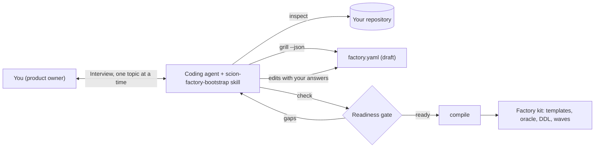
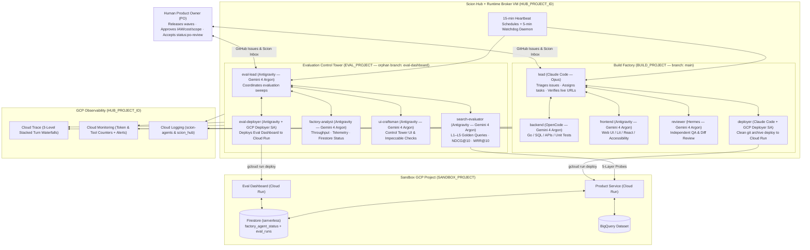

# Scion defaults

Scion defaults helps you bootstrap an always-on, self-healing multi-agent software factory on
[Scion](https://github.com/GoogleCloudPlatform/scion) for a new project. You work with an agentic coding agent, such as
Antigravity, Claude Code, or OpenCode. The agent inspects your repository, interviews you about your project, and
generates a complete factory kit: agent templates for a build team and an independent evaluation team, a knowledge
plane, an evaluation oracle, a serverless Firestore control plane for agent status and evaluation runs, and a seeded
backlog. Git is optional: you can start without it and
add it later.

The defaults come from two factories that ran in production on a self-hosted Scion Hub: a 10-agent hybrid search
factory and a 14-agent airline-operations factory. Every interview question traces back to a documented production
failure in [`docs/lessons-learned.md`](docs/lessons-learned.md) (lessons L1–L28).

> [!IMPORTANT]
> Always use this repository through an agentic coding agent. The scripts in this repository don't interview you,
> and they don't make design decisions. The agent conducts the interview, and the scripts only inspect, draft,
> validate, and compile.

## How it works

The workflow splits responsibilities between your coding agent and deterministic tools. The agent handles the work
that needs judgment. The tools handle the work that must be repeatable.

| Component | Role | Type |
|---|---|---|
| [`skills/scion-factory-bootstrap/SKILL.md`](skills/scion-factory-bootstrap/SKILL.md) | Turns your coding agent into an interviewer. The agent reads your code, asks one topic at a time, and challenges vague answers with evidence from lessons L1–L27. | Agentic |
| [`scripts/scion-factory`](scripts/scion_factory.py) | Detects facts from your repository, writes a draft specification, scores readiness, and compiles the factory kit. It makes no LLM calls and never waits for keyboard input. | Deterministic |
| Generated factory kit | A 10-to-14 agent Scion factory that you deploy to a Scion Hub. | Multi-agent system |



The factory is serverless wherever possible. Agents run on the Scion Hub, products deploy to Cloud Run, and the
factory's own data (agent status and evaluation runs) lives in Firestore, so there is no database instance to size or
pay for while idle. The interview steers products toward serverless stores too, and asks you to justify a
provisioned store such as Spanner, AlloyDB, or Cloud SQL.

The tools separate two kinds of information:

- **Static facts** are things your repository already states, such as the language, build and test commands, the
  exposed port, cloud SDK dependencies, existing requirements, ADRs, and API contracts, and the GitHub remote. The
  agent detects these and asks you only to confirm them.
- **Intent** is information that only you can supply, such as the mission, non-goals, whether to use Git, deployer
  permissions, requirements and invariants, the quality metric and its threshold, latency targets, and the first
  backlog wave. The draft specification leaves these fields empty, so the readiness gate fails until the agent gets
  real answers from you.

## Set up a factory end to end

This tutorial takes you from a Google Cloud project to a running factory for an existing repository. Your coding agent
interviews you about the repository, compiles the factory kit, and you start the agents on a Scion Hub.

Choose where the factory runs:

| Option | When to choose it | Steps |
|---|---|---|
| **New project and Hub** | You don't have a Scion Hub yet. Plan for about two hours; most of it is the Hub building its container images. | Steps 1 to 8 |
| **Existing project and Hub** | A Scion Hub already runs in a Google Cloud project, deployed with Scion's single-node installer, possibly with other factories on it. Plan for about one hour. | [Use an existing Scion Hub](#use-an-existing-scion-hub), then steps 3 to 8 |

The tutorial uses one Google Cloud project for both the Hub and the agents' sandbox. That's enough for a trial. For
production, keep them separate, as the [setup runbook](docs/setup-runbook.md) recommends, so agents can't affect the
Hub. The tutorial also assumes that you answer "use Git" in the interview. Without Git, steps 5 and 6 differ; see
[Choose whether to use Git](#choose-whether-to-use-git) and step 6 of the setup runbook.

### Before you begin

1. Make sure that you have the following:

   - For a new Hub: a Google Cloud organization and a billing account, and permission to create projects in the
     organization. For an existing Hub: SSH access to its VM through IAP (for example, the project's Owner or the
     Compute OS Admin Login and IAP-secured Tunnel User roles), and a Google account that is an admin on the Hub.
   - An existing GitHub repository for your product, and a GitHub token that can read and write its contents,
     issues, and pull requests. Every agent acts as the token's owner.
   - `gcloud` with the `beta` component, `gh`, `git` 2.42 or later, `jq`, `openssl`, `python3`, and
     [`uv`](https://docs.astral.sh/uv/). Docker isn't needed on your machine.
   - An agentic coding agent that supports skills, such as Antigravity or Claude Code.

1. Clone this repository, and make the interview skill available to your agent. For Antigravity:

   ```bash
   git clone https://github.com/duboc/scion-defaults.git
   ln -s "$PWD/scion-defaults/skills/scion-factory-bootstrap" ~/.gemini/config/skills/scion-factory-bootstrap
   ```

   For Claude Code, link the same directory into `~/.claude/skills/`. For other agents, point the agent at
   [`skills/scion-factory-bootstrap/SKILL.md`](skills/scion-factory-bootstrap/SKILL.md).

1. Set the values that the following steps use. Replace each placeholder:

   ```bash
   export HUB_PROJECT_ID=PROJECT_ID          # new Hub: a new, globally unique ID; existing Hub: its project
   export ADMIN_EMAIL=ADMIN_EMAIL            # your Google account; the Hub admin who acts as product owner
   export ORGANIZATION_ID=ORGANIZATION_ID    # new Hub only
   export BILLING_ACCOUNT_ID=BILLING_ACCOUNT_ID   # new Hub only
   ```

### Step 1: Create a Google Cloud project for the Hub

```bash
gcloud projects create "$HUB_PROJECT_ID" --organization="$ORGANIZATION_ID"
gcloud billing projects link "$HUB_PROJECT_ID" --billing-account="$BILLING_ACCOUNT_ID"
gcloud services enable compute.googleapis.com cloudresourcemanager.googleapis.com --project="$HUB_PROJECT_ID"
gcloud compute networks describe default --project="$HUB_PROJECT_ID" >/dev/null 2>&1 \
  || gcloud compute networks create default --project="$HUB_PROJECT_ID" --subnet-mode=auto
```

Some organizations don't create a `default` network in new projects; the last command creates it when it's missing.

### Step 2: Deploy the Scion Hub

1. Get Scion's single-node installer for the release that this tutorial is tested with, and write its
   configuration. The installer and the Hub binary must come from the same release:

   ```bash
   export SCION_VERSION=nightly-20261022
   git clone --depth 1 --branch "$SCION_VERSION" https://github.com/GoogleCloudPlatform/scion.git
   cat > hub-config.json <<EOF
   {"hub_name": "factory", "project_id": "$HUB_PROJECT_ID", "region": "us-central1",
    "machine_size": "small", "disk_size_gb": 200, "chat_plugins": [],
    "container_images": {"source": "build", "registry": "", "force_rebuild": false},
    "admin_email": "$ADMIN_EMAIL", "hub_sa_minting": false,
    "update_policy": "notify", "release_channel": "nightly"}
   EOF
   ```

1. Run the installer. It creates the VM `scion-hub-factory`, an IAP-protected web UI on Cloud Run, and builds the
   container images on the VM:

   ```bash
   (cd scion/scripts/single-node-vm && ./deploy.sh --version "$SCION_VERSION" --config "$PWD/../../../hub-config.json" < /dev/null)
   ```

   Without `--version`, the installer takes the newest nightly. A newer release can work, but `nightly-20261023`
   doesn't start on a fresh install: the Hub refuses its default `http://localhost:8080` base URL before the
   installer configures IAP, and the health check fails.

   When it finishes, the output ends with `=== Deployment Complete ===`, the zone of the VM, and the
   `Access URL`. If the installer stops on a temporary IAP SSH error (`502 Bad Gateway`) or on a service account
   that "does not exist" right after it was created, run the same command again. The installer skips the work that's
   already done.

   The installer always uses the first zone of the region. If it stops with `ZONE_RESOURCE_POOL_EXHAUSTED`, set
   another `region` in `hub-config.json` and run it again. Then update the proxy firewall rule, which keeps the
   first region's subnet (the installer only warns about it), or the `Access URL` answers `Bad Gateway`:

   ```bash
   gcloud compute firewall-rules update scion-hub-factory-allow-proxy --project="$HUB_PROJECT_ID" \
     --source-ranges="$(gcloud compute networks subnets describe default --region=NEW_REGION \
       --project="$HUB_PROJECT_ID" --format='value(ipCidrRange)')"
   ```

1. Open the `Access URL` in your browser, and sign in as `ADMIN_EMAIL`. The Hub creates its admin user at the first
   sign-in, and the scripts in this repository act as that user.

1. Build the harness images that your roster needs. The installer builds only the Antigravity image; the default
   roster also uses Claude Code. Add `opencode` or `hermes` to the list if your roster uses them. Replace `HUB_ZONE`
   with the zone that the installer printed:

   ```bash
   gcloud compute ssh scion-hub-factory --project="$HUB_PROJECT_ID" --zone=HUB_ZONE --tunnel-through-iap \
     --command='sudo -u scion bash -c "cd /opt/scion-source && for h in claude; do docker build -q -t scion-\$h:latest --build-arg BASE_IMAGE=scion-base:latest -f harnesses/\$h/Dockerfile harnesses/\$h/ && docker tag scion-\$h:latest localhost/scion/scion-\$h:latest; done"'
   ```

   Claude Code and Antigravity run on a stock Hub. OpenCode and Hermes need the harness patches in step 7 of the
   [setup runbook](docs/setup-runbook.md): without them, OpenCode stops at a permission prompt, and the Hermes
   harness that ships with `nightly-20261022` crashes at start.

1. In the Google Cloud console, open Vertex AI Model Garden for `HUB_PROJECT_ID`, and enable the Claude model that
   your lead and deployer roles use. Without it, Claude Code starts but can't answer.

### Use an existing Scion Hub

Skip steps 1 and 2 when a Scion Hub already runs in `HUB_PROJECT_ID`. You add the factory as two new Hub projects next
to whatever runs there; nothing that exists is changed.

1. Find the Hub VM and its zone. Scion's installer names the VM `scion-hub-HUB_NAME`:

   ```bash
   gcloud compute instances list --project="$HUB_PROJECT_ID" --filter="name~^scion-hub" \
     --format="table(name,zone.basename(),status)"
   ```

   Note the `NAME` and `ZONE`. You set them as `HUB_VM` and `HUB_ZONE` in step 4. The Hub's OS user is `scion` on
   installer-built VMs.

1. Open the Hub web UI, and sign in as `ADMIN_EMAIL`. That account must be one of the Hub's admins
   (`admin_emails` in its settings). The scripts act as this user, and the Hub creates the user at the first sign-in.

1. Decide where the agents build and deploy. You can reuse `HUB_PROJECT_ID` as the sandbox or point
   `SANDBOX_PROJECT` at a separate project in step 4. Step 5 creates what the sandbox needs in that project.

1. Continue with step 3. In step 4, the preflight checks the Hub: its health, your admin user, the harness images,
   the projects that already exist, and the factories that the watchdog and the status sync already cover.

### Step 3: Design the agents from your repository with an interview

1. Open your coding agent in the `scion-defaults` directory, and give it the following request. Replace
   `TARGET_REPO_PATH` with the path to a local clone of your product repository:

   ```none
   Bootstrap a Scion software factory for TARGET_REPO_PATH using the scion-factory-bootstrap skill.
   ```

1. Confirm the facts that the agent detects, such as the language, build and test commands, port, cloud
   dependencies, existing requirements and ADRs, and the GitHub remote.

1. Answer the interview. The agent asks about six topics, one at a time, and pushes back on answers that it can't
   test. [The interview](#the-interview) lists the topics and why each one matters.

1. When the readiness gate passes, tell the agent where to write the kit, for example `../my-factory-kit`. The
   agent compiles and checks it:

   ```bash
   ./scripts/scion-factory compile factory.yaml --out OUTPUT_DIR
   OUTPUT_DIR/scripts/verify-factory.sh
   ```

   The output is similar to `Compiled 56 boilerplate files into OUTPUT_DIR`. The following steps call that
   directory `OUTPUT_DIR`; set it once:

   ```bash
   export OUTPUT_DIR="$PWD/../my-factory-kit"
   ```

### Step 4: Configure the deployment scripts

1. Copy the kit's configuration into this repository. `config/*.env` files are git-ignored. Use one file per factory,
   and point `FACTORY_ENV` at it; every script reads that file:

   ```bash
   cp "$OUTPUT_DIR/config/factory.env.example" config/my-factory.env
   export FACTORY_ENV="$PWD/config/my-factory.env"
   ```

1. Edit the file, and set the Hub and sandbox values. The kit already filled in the factory values,
   such as `BUILD_PROJECT`, `EVAL_PROJECT`, `GITHUB_REPO`, the branches, and the agent roster.

   | Variable | New Hub (steps 1 and 2) | Existing Hub |
   |---|---|---|
   | `HUB_PROJECT` | `HUB_PROJECT_ID` | `HUB_PROJECT_ID` |
   | `HUB_ZONE` | the zone that the installer printed | the `ZONE` you noted |
   | `HUB_VM` | `scion-hub-factory` | the `NAME` you noted |
   | `HUB_OS_USER` | `scion` | `scion` |
   | `SANDBOX_PROJECT`, `FIRESTORE_PROJECT` | `HUB_PROJECT_ID` | `HUB_PROJECT_ID` or your separate sandbox project |
   | `PO_EMAIL` | `ADMIN_EMAIL` | `ADMIN_EMAIL` |
   | `DATA_BUCKET` | `HUB_PROJECT_ID-factory-data` | a bucket name in the sandbox project |

   On an existing Hub, choose `BUILD_PROJECT` and `EVAL_PROJECT` slugs that no project on the Hub uses yet.

1. Load the values into your shell, and run the read-only preflight on the Hub:

   ```bash
   set -a; . "$FACTORY_ENV"; set +a
   scripts/run-on-hub.sh scripts/hub-preflight.py
   ```

   The output is similar to the following:

   ```none
   Scion nightly-20261022  PO admin: ADMIN_EMAIL
   existing projects: shop, shop-eval
   harness-configs:   antigravity, claude, hermes, opencode
   watchdog covers:   shop, shop-eval
   sync covers:       shop, shop-eval
   WARN  no scion-claude image: agents on the claude harness can't start until you build it

   Install the watchdog and the sync with:
     FACTORY_PROJECTS=shop,shop-eval,pulse-ledger,pulse-ledger-eval
   ```

   Fix every `ERROR` before you continue. For a missing image, run the image build from step 2 against `HUB_VM`. Set
   `FACTORY_PROJECTS` in your env file to the value that the preflight prints, so the watchdog and the sync
   keep covering the factories that already run on the Hub, and load the file again.

### Step 5: Prepare the sandbox and the repository

1. Create the sandbox resources: the deployer and runtime service accounts, IAM, and the Firestore database and
   indexes for the factory's control plane. Review the plan first:

   ```bash
   DRY_RUN=1 scripts/setup-sandbox.sh
   scripts/setup-sandbox.sh
   ```

1. Add the knowledge plane to your repository's build branch. `cp -n` keeps any file that already exists:

   ```bash
   cd TARGET_REPO_PATH
   cp -Rn "$OUTPUT_DIR/knowledge-plane" .
   python3 knowledge-plane/kp-check.py
   git add knowledge-plane && git commit -m "docs: add the factory knowledge plane" && git push origin "$BUILD_BRANCH"
   ```

1. Create the evaluation trunk as an orphan branch, so evaluation code never shares history with product code:

   ```bash
   git worktree add --orphan -b "$EVAL_BRANCH" ../eval-trunk
   cp -R "$OUTPUT_DIR/eval-workspace/." ../eval-trunk/
   git -C ../eval-trunk add -A && git -C ../eval-trunk commit -m "chore(eval): independent evaluation trunk"
   git -C ../eval-trunk push -u origin "$EVAL_BRANCH"
   cd -
   ```

1. Create the labels and the first backlog waves as GitHub issues. Review the dry run, then create them:

   ```bash
   gh label create "$BUILD_PROJECT" -R "$GITHUB_REPO" --force
   gh label create "$EVAL_PROJECT" -R "$GITHUB_REPO" --force
   "$OUTPUT_DIR/scripts/seed-github-waves.sh"
   DRY_RUN=0 "$OUTPUT_DIR/scripts/seed-github-waves.sh"
   ```

### Step 6: Create the Hub projects

1. Put your GitHub token on the VM for the Hub's OS user. The token travels over SSH stdin, so it never appears on
   a command line:

   ```bash
   read -rs GITHUB_PAT; printf '%s' "$GITHUB_PAT" | gcloud compute ssh "$HUB_VM" --project="$HUB_PROJECT" \
     --zone="$HUB_ZONE" --tunnel-through-iap \
     --command="sudo -u $HUB_OS_USER sh -c 'umask 077; cat > ~/.factory-github-token'"; unset GITHUB_PAT
   ```

1. Create the build and evaluation projects. Each one gets a shared checkout of its branch, and the Hub stores the
   token as the project's `GITHUB_TOKEN` secret:

   ```bash
   scripts/run-on-hub.sh scripts/scion-admin.py project-create --slug "$BUILD_PROJECT" \
     --git-url "https://github.com/$GITHUB_REPO.git" --branch "$BUILD_BRANCH" --mode shared --token-file '~/.factory-github-token'
   scripts/run-on-hub.sh scripts/scion-admin.py project-create --slug "$EVAL_PROJECT" \
     --git-url "https://github.com/$GITHUB_REPO.git" --branch "$EVAL_BRANCH" --mode shared --token-file '~/.factory-github-token'
   ```

1. Add the shared directories: a read-write `scratchpad` and a read-only `knowledge-plane` copy in each project:

   ```bash
   scripts/run-on-hub.sh scripts/scion-admin.py shared-dirs --apply
   ```

### Step 7: Push the agent templates

Upload the kit's templates to their projects. Each command is a dry run without `--apply`:

```bash
scripts/push-templates.py --project "$BUILD_PROJECT" --templates "$OUTPUT_DIR/templates" \
  --roles "$(echo "$BUILD_AGENTS" | tr ' ' ',')" --apply
scripts/push-templates.py --project "$EVAL_PROJECT" --templates "$OUTPUT_DIR/templates" \
  --roles "$(echo "$EVAL_AGENTS" | tr ' ' ',')" --apply
```

Each run ends with `other templates unchanged: yes`.

### Step 8: Start the factory

1. Install the watchdog and the agent-status sync. The watchdog copies the knowledge plane into the shared
   directories right away and then every five minutes; the sync writes agent status to Firestore every minute. Both
   cover the projects in `FACTORY_PROJECTS`, which on an existing Hub is the merged list from the preflight:

   ```bash
   scripts/run-on-hub.sh scripts/factory-watchdog.py --install-cron --apply
   scripts/install-sync-cron.sh
   ```

1. Start the two leads. Each lead starts its own team at its first wake-up, so every team member is the lead's
   child in Scion: the project's tree view shows the lead on top, and the Hub sends the lead its team's
   notifications. Agent names are the role names, with the `AGENT_PREFIX` in a monorepo:

   ```bash
   scripts/run-on-hub.sh scripts/scion-admin.py scion start "${AGENT_PREFIX:+$AGENT_PREFIX-}lead" -t lead --project="$BUILD_PROJECT" \
     --harness-auth vertex-ai "Read your instructions, then run your wake-up steps."
   scripts/run-on-hub.sh scripts/scion-admin.py scion start "${AGENT_PREFIX:+$AGENT_PREFIX-}eval-lead" -t eval-lead --project="$EVAL_PROJECT" \
     --harness-auth vertex-ai "Read your instructions, then run your wake-up steps."
   ```

   Within a few minutes, `scripts/run-on-hub.sh scripts/scion-admin.py scion list --all` lists every role in
   `BUILD_AGENTS` and `EVAL_AGENTS`. The leads start deployer roles with `--service-account ID` when the deployer
   service account is registered in the project; see step 6 of the [setup runbook](docs/setup-runbook.md).

1. Schedule the lead's heartbeat, and tell the lead to start working:

   ```bash
   hb="$(scripts/render-templates.py --file "$OUTPUT_DIR/config/heartbeat-message.txt")"
   scripts/run-on-hub.sh scripts/scion-admin.py schedule create --project "$BUILD_PROJECT" \
     --name "$BUILD_PROJECT-lead-heartbeat" --cron "*/15 * * * *" --agent "${AGENT_PREFIX:+$AGENT_PREFIX-}lead" --text "$hb"
   scripts/run-on-hub.sh scripts/scion-admin.py message --project "$BUILD_PROJECT" --agent "${AGENT_PREFIX:+$AGENT_PREFIX-}lead" --text \
     "PO -> lead: GO. Work the backlog in wave order, at most 2 issues in flight, evidence on every issue."
   ```

### Verify the factory

- `scripts/run-on-hub.sh scripts/scion-admin.py scion list --project="$BUILD_PROJECT"` shows every build agent as
  `running`.
- `scripts/run-on-hub.sh scripts/factory-status.sh --panes 10` shows each agent's terminal at a prompt, with no
  trust or login screen.
- Within one heartbeat, the lead comments a plan on the first wave issue and briefs a worker.
- After the first deploy, run `SERVING_URL=URL EVAL_URL=URL "$OUTPUT_DIR/scripts/verify-factory.sh"` to check
  the live endpoints.

From here on, operate the factory with the [operations runbook](docs/operations-runbook.md). The
[setup runbook](docs/setup-runbook.md) covers what this tutorial skips: telemetry, backups, alerts, and budgets.

### Clean up

On a Hub you created for this tutorial, delete the project to stop all charges. This deletes the Hub, the agents, and
the sandbox:

```bash
gcloud projects delete "$HUB_PROJECT_ID"
```

On an existing Hub, remove only the factory. Deleting a project with `--force` also removes its agents. Then
reinstall the watchdog and the sync with `FACTORY_PROJECTS` set to the factories that remain:

```bash
scripts/run-on-hub.sh scripts/scion-admin.py scion hub projects delete "$BUILD_PROJECT" --yes --force
scripts/run-on-hub.sh scripts/scion-admin.py scion hub projects delete "$EVAL_PROJECT" --yes --force
```

The GitHub repository keeps the knowledge plane, the evaluation branch, and the wave issues. The Hub keeps a small
marker per deleted slug in `~/.scion/hub-workspaces/` on the VM; remove it before you reuse the slug. The sandbox
resources that `scripts/setup-sandbox.sh` created stay too; to remove them, follow the teardown notes in
[L29](docs/lessons-learned.md#l29-a-real-monorepo-kubernetes-as-three-factories-and-leads-that-start-their-own-teams).

## The interview

The agent asks about six topics, one at a time. Expect it to push back when an answer isn't specific enough to test.
For example, "it must be fast" isn't accepted as a latency target.

| Topic | What you decide | Why it matters |
|---|---|---|
| Mission and boundaries | The mission, at least two non-goals, and whether to use Git now. With Git, also the repository and the build and evaluation branches. | Without non-goals, agents expand scope or escalate product decisions to you (L4, L25). |
| Runtime, data, and IAM | Build, test, and lint commands, cloud stores, and the exact IAM roles for the deployer service account. | A missing role blocked the first wave of the search factory mid-sprint (L5). |
| Roster, models, and cost | Build and evaluation roles, harness and model per role, heartbeat mode, WIP limit, and budget. | Each harness has runtime requirements, and idle heartbeats on expensive models waste budget (L6, L9, L22). |
| Evaluation pyramid | The health endpoint, API contract invariants, a numeric domain quality metric and threshold, safety invariants, and latency targets (p50, p95, p99). | Without a numeric oracle, the evaluation team can't grade a wave or file regressions (L15, L25). |
| Backlog waves | Wave 1 and wave 2 items with an owner role, testable acceptance criteria, and the requirement IDs they deliver. | The lead agent dispatches work only from ready backlog items (L1, L2, L18). |
| Knowledge plane | Which existing documents to learn from, and the requirements, invariants, and decisions that are missing. | When the reviewer couldn't find the real ADR paths, it guessed, issued a wrong FAIL, and the factory deadlocked for about 60 hours (L4). |

The agent doesn't compile until `scripts/scion-factory check factory.yaml` passes. To prepare your answers, read
[`docs/grill-me-playbook.md`](docs/grill-me-playbook.md).

## Review the generated factory kit

The compiled kit contains the following files:

| Path | Contents |
|---|---|
| `factory.yaml` | The validated specification, which is the source of truth for the kit. |
| `AGENTS.md` | The project architecture, verification commands, agent roster, and evaluation pyramid. |
| `config/factory.env.example` | Environment variables for the Hub, the application project, and the agent roster. |
| `config/firestore/` | The Firestore data contract, composite indexes, and security rules for agent status (`factory_agent_status`) and evaluation runs (`eval_runs`). |
| `eval-workspace/tools/factory_store.py` | The Firestore client that evaluation agents use to read agent status and record evaluation runs. |
| `config/heartbeat-message.txt` | The message that the heartbeat schedule sends to the lead agent. |
| `templates/_shared/agents.md` | The shared operating protocol that every agent follows. |
| `templates/ROLE/` | The `scion-agent.yaml`, `system-prompt.md`, and `agents.md` files for each role. |
| `knowledge-plane/` | The knowledge plane. See [Understand the knowledge plane](#understand-the-knowledge-plane). |
| `eval-workspace/golden/` | Notes for the evaluation team's golden datasets. Copy this directory to the evaluation workspace only. |
| `waves/issues.json` | The backlog waves. |
| `backlog/issues.json` | Without Git only: the live backlog. The lead is the only writer. |
| `scripts/seed-github-waves.sh` | With Git only: creates status labels and wave issues in GitHub. The script is a dry run unless you set `DRY_RUN=0`. |
| `scripts/enable-git.sh` | Without Git only: adds Git and GitHub to the running factory. See [Add Git later](#add-git-later). |
| `scripts/verify-factory.sh` | Checks the kit artifacts and, optionally, the live L1 and L3 endpoints. |

When you recompile, the tool never overwrites `knowledge-plane/`, `backlog/`, or `eval-workspace/`, because agents
edit them after bootstrap. To reseed them, add `--force-knowledge`.

## Understand the knowledge plane

Every agent reads `knowledge-plane/INDEX.md` before it plans, implements, reviews, or deploys. Evaluation agents read
the same files read-only at `/scion-volumes/knowledge-plane`, which the watchdog keeps in sync.

```none
knowledge-plane/
├── INDEX.md                 # Routes each task to a file, and links learned sources in place
├── product/requirements.md  # Requirements with stable REQ- IDs and acceptance criteria
├── adr/                     # Decisions with ADR- IDs, plus _template.md
├── contracts/README.md      # API and data contracts: the source of truth for L2 checks
├── invariants.md            # Numbered MUST rules: the reviewer's checklist
├── glossary.md              # Domain terms
├── playbooks/README.md      # Procedures specific to this project
├── state/LIVE.md            # Live revision and rollback target; only the deployer writes it
└── kp-check.py              # Fails on broken links and unknown REQ-/ADR- IDs
```

The agent builds the knowledge plane in one of two ways, and can combine them:

- **Learned from your repository:** existing requirements, ADRs, contracts, design docs, and guides stay where they
  are. The index links to them, and the agent proposes requirements and invariants extracted from them for you to
  confirm.
- **Generated with you:** when sources are missing, the agent elicits requirements, invariants, and decisions in the
  interview.

Golden datasets for the L3 quality metric never go into the knowledge plane. They stay with the evaluation team, so
the build team can't tune the product to the test.

## Choose whether to use Git

| | With Git | Without Git |
|---|---|---|
| Backlog | GitHub issues with `status:*` labels | `backlog/issues.json`, written only by the lead |
| Integration | Commit slot and pushes to the build branch | Edit slot in the shared workspace |
| Deploy source | `git archive` of the verified commit | A `tar` snapshot of the workspace, with its SHA-256 recorded in `state/LIVE.md` |
| Evaluation isolation | Orphan evaluation branch | A separate Hub project workspace |

## Add Git later

If your factory started without Git, add it without rebuilding the factory:

1. Create an empty GitHub repository, and make sure that the Hub OS user can push to it.
1. On the Hub VM, review the plan in dry-run mode. Replace `OWNER/NAME` with your repository:

   ```bash
   GITHUB_REPO=OWNER/NAME OUTPUT_DIR/scripts/enable-git.sh
   ```

   The script migrates `backlog/issues.json` to GitHub issues with their current status, repoints the knowledge plane
   index, imports the build workspace into the build branch, and imports the evaluation workspace as an orphan branch.
   It adds `.env` files, `.scion/`, `node_modules/`, and `.venv/` to `.gitignore` before the first commit.

1. Run the same command with `DRY_RUN=0`.
1. Switch the specification to Git mode, and recompile the kit:

   ```bash
   ./scripts/scion-factory enable-git factory.yaml --repo OWNER/NAME
   ./scripts/scion-factory compile factory.yaml --out OUTPUT_DIR
   ```

1. Push the regenerated templates to the Hub, and restart the agents.

## Run several factories in one monorepo

When one repository holds several products (`src/project1`, `src/project2`, …), each product can get its own factory
on the same Hub. Agents are named after their factory (`project1-lead`), start in their product folder while keeping
the whole repository, and read their own product's knowledge plane. Follow
[Several factories in one monorepo](docs/setup-runbook.md#several-factories-in-one-monorepo) in the setup runbook.

## Reference implementation

The defaults in this repository come from the following topology, which ran on a single self-hosted Scion Hub VM on
Google Cloud.



The repository encodes the following capabilities from that implementation:

- **Multi-harness fleet:** Templates and provisioner patches for Antigravity, OpenCode, and Hermes on Gemini 4 Argon
  through the Vertex AI global endpoint, and for Claude Code on Opus.
- **Self-sustaining orchestration:** 15-minute heartbeat schedules through
  [`scripts/scion-admin.py`](scripts/scion-admin.py), and a 5-minute watchdog,
  [`scripts/factory-watchdog.py`](scripts/factory-watchdog.py), that repairs drift, wakes stalled agents with a
  circuit breaker, and forwards escalations to Cloud Logging.
- **Stacked traces:** [`patches/sciontool-stacked-traces/`](patches/sciontool-stacked-traces/README.md) produces one
  three-level Cloud Trace waterfall per agent turn, linked across turns.
- **Evaluation control tower:** [`scripts/sync-factory-agents.py`](scripts/sync-factory-agents.py) syncs agent state
  and telemetry counters to Firestore every minute, and
  [`docs/verification-and-eval.md`](docs/verification-and-eval.md) defines the L1–L5 evaluation pyramid.
- **Production guardrails:** Orphan-branch isolation for evaluation code, clean `git archive` deployments with
  `--to-latest`, daily disk snapshots and SQLite backups, alerts, and billing budgets.

The three presets in [`presets/`](presets/) reproduce this lineage as specifications. Use them as worked examples
during the interview:

- [`starter-service.factory.yaml`](presets/starter-service.factory.yaml): A double-entry ledger API, which shows a
  non-search domain.
- [`psearch.factory.yaml`](presets/psearch.factory.yaml): The 10-agent hybrid search factory.
- [`acme-airlines.factory.yaml`](presets/acme-airlines.factory.yaml): The 14-agent airline-operations factory with
  dedicated heartbeat sensor agents.

## Repository layout

| Path | Contents |
|---|---|
| [`skills/scion-factory-bootstrap/`](skills/scion-factory-bootstrap/SKILL.md) | The agent skill that drives the bootstrap workflow. |
| [`docs/grill-me-playbook.md`](docs/grill-me-playbook.md) | The interview questions, the lesson behind each question, and the readiness gate rules. |
| [`scripts/scion_factory.py`](scripts/scion_factory.py) | The deterministic tool that the agent calls: `inspect`, `grill`, `check`, `compile`, and `enable-git`. |
| [`scripts/knowledge_plane.py`](scripts/knowledge_plane.py) | Knowledge-source detection, knowledge plane rendering, and the `kp-check.py` checker. |
| [`docs/plans/`](docs/plans/) | Design specs for the bootstrap tool. |
| [`config/factory.schema.json`](config/factory.schema.json) | The JSON Schema for `factory.yaml`. |
| [`presets/`](presets/) | Worked example specifications. |
| [`docs/`](docs/) | Architecture, setup and operations runbooks, the agent protocol, the evaluation pyramid, lessons learned, and the orchestration spec. |
| [`docs/telemetry/`](docs/telemetry/README.md) | ASD-STE100 guides for telemetry, the evaluation data pipeline, and harness hooks. |
| [`templates/`](templates/README.md) | The shared protocol and the 10 role templates from the reference implementation. |
| [`scripts/`](scripts/README.md) | Hub administration, provisioning, telemetry, patching, sync, watchdog, backup, and alerting scripts. |
| [`patches/sciontool-stacked-traces/`](patches/sciontool-stacked-traces/README.md) | The `sciontool` patch for stacked Cloud Trace waterfalls. |

## Contribute

Run the test suite before you change the tools or the presets:

```bash
uv run --with pytest --with pyyaml --with jsonschema pytest tests -q
```

The tests check repository and knowledge-source detection, interview coverage, the readiness gate, domain-leak-free
compilation, the knowledge plane, compilation with and without Git, the switch to Git, and the schema.

This repository contains no secrets, tokens, or real project identifiers. Real values belong in the git-ignored
`config/factory.env`. Before you commit, run the secret scan in [`AGENTS.md`](AGENTS.md).

## What's next

- Read [`docs/grill-me-playbook.md`](docs/grill-me-playbook.md) to prepare your answers before the interview.
- Read [`docs/lessons-learned.md`](docs/lessons-learned.md) to understand the failure behind each default.
- Read [`docs/setup-runbook.md`](docs/setup-runbook.md) for every deployment option, including separate Hub and
  sandbox projects, telemetry, backups, and alerts.
- Read [`docs/operations-runbook.md`](docs/operations-runbook.md) to run the factory day to day.
