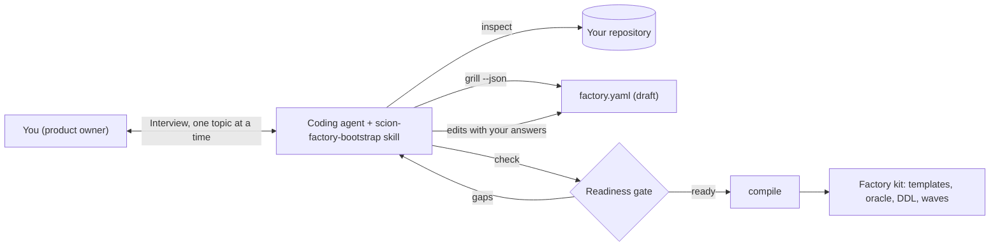
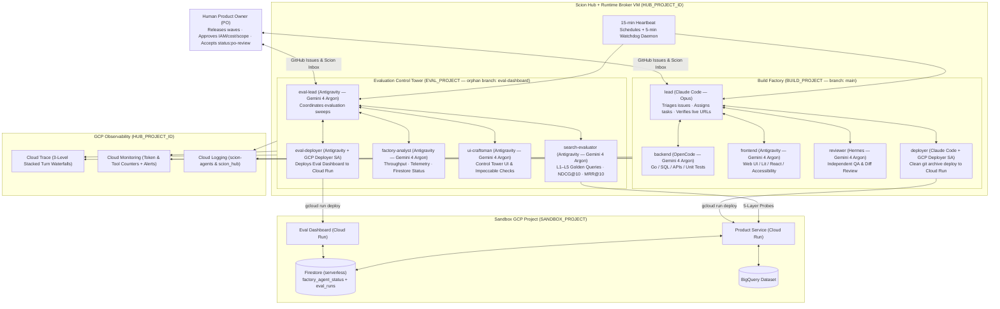

# Scion defaults

Scion defaults helps you bootstrap an always-on, self-healing multi-agent software factory on
[Scion](https://github.com/GoogleCloudPlatform/scion) for a new project. You work with an agentic coding agent, such as
Antigravity, Claude Code, or OpenCode. The agent inspects your repository, interviews you about your project, and
generates a complete factory kit: agent templates for a build team and an independent evaluation team, a knowledge
plane, an evaluation oracle, a serverless Firestore control plane for agent status and evaluation runs, and a seeded
backlog. Git is optional: you can start without it and
add it later.

The defaults come from two factories that ran in production on a self-hosted Scion Hub: a 10-agent hybrid search
factory and a 14-agent airline-operations factory. Every interview question traces back to a documented production
failure in [`docs/lessons-learned.md`](docs/lessons-learned.md) (lessons L1–L28).

> [!IMPORTANT]
> Always use this repository through an agentic coding agent. The scripts in this repository don't interview you,
> and they don't make design decisions. The agent conducts the interview, and the scripts only inspect, draft,
> validate, and compile.

## How it works

The workflow splits responsibilities between your coding agent and deterministic tools. The agent handles the work
that needs judgment. The tools handle the work that must be repeatable.

| Component | Role | Type |
|---|---|---|
| [`skills/scion-factory-bootstrap/SKILL.md`](skills/scion-factory-bootstrap/SKILL.md) | Turns your coding agent into an interviewer. The agent reads your code, asks one topic at a time, and challenges vague answers with evidence from lessons L1–L27. | Agentic |
| [`scripts/scion-factory`](scripts/scion_factory.py) | Detects facts from your repository, writes a draft specification, scores readiness, and compiles the factory kit. It makes no LLM calls and never waits for keyboard input. | Deterministic |
| Generated factory kit | A 10-to-14 agent Scion factory that you deploy to a Scion Hub. | Multi-agent system |



The factory is serverless wherever possible. Agents run on the Scion Hub, products deploy to Cloud Run, and the
factory's own data (agent status and evaluation runs) lives in Firestore, so there is no database instance to size or
pay for while idle. The interview steers products toward serverless stores too, and asks you to justify a
provisioned store such as Spanner, AlloyDB, or Cloud SQL.

The tools separate two kinds of information:

- **Static facts** are things your repository already states, such as the language, build and test commands, the
  exposed port, cloud SDK dependencies, existing requirements, ADRs, and API contracts, and the GitHub remote. The
  agent detects these and asks you only to confirm them.
- **Intent** is information that only you can supply, such as the mission, non-goals, whether to use Git, deployer
  permissions, requirements and invariants, the quality metric and its threshold, latency targets, and the first
  backlog wave. The draft specification leaves these fields empty, so the readiness gate fails until the agent gets
  real answers from you.

## Before you begin

1. Install an agentic coding agent that supports skills, such as Antigravity or Claude Code.
1. Install [`uv`](https://docs.astral.sh/uv/). The `scripts/scion-factory` wrapper uses `uv` to provide PyYAML. If
   `uv` isn't available, the wrapper falls back to `python3`.
1. Clone this repository:

   ```bash
   git clone https://github.com/duboc/scion-defaults.git
   ```

1. Make the skill available to your agent. For example, for Antigravity:

   ```bash
   ln -s "$PWD/scion-defaults/skills/scion-factory-bootstrap" ~/.gemini/config/skills/scion-factory-bootstrap
   ```

   For Claude Code, link the same directory into `~/.claude/skills/`. For other agents, see your agent's
   documentation for its skills directory, or point the agent at the `SKILL.md` file directly.

## Bootstrap a new factory

1. Open your coding agent in the `scion-defaults` directory, and give it a request such as the following. Replace
   `TARGET_REPO_PATH` with the path to your project's repository:

   ```none
   Bootstrap a Scion software factory for TARGET_REPO_PATH using the scion-factory-bootstrap skill.
   ```

   If your project doesn't have a repository yet, describe the project instead. The agent starts from an empty draft.

1. Review the facts that the agent detects. The agent runs `scripts/scion-factory inspect` and
   `scripts/scion-factory grill --json`, shows you a summary of the detected stack, and writes a draft
   `factory.yaml`. Confirm or correct the detected values.

1. Answer the interview. The agent asks about six topics, one at a time. Expect the agent to push back when an answer
   isn't specific enough to test. For example, "it must be fast" isn't accepted as a latency target.

   | Topic | What you decide | Why it matters |
   |---|---|---|
   | Mission and boundaries | The mission, at least two non-goals, and whether to use Git now. With Git, also the repository and the build and evaluation branches. | Without non-goals, agents expand scope or escalate product decisions to you (L4, L25). |
   | Runtime, data, and IAM | Build, test, and lint commands, cloud stores, and the exact IAM roles for the deployer service account. | A missing role blocked the first wave of the search factory mid-sprint (L5). |
   | Roster, models, and cost | Build and evaluation roles, harness and model per role, heartbeat mode, WIP limit, and budget. | Each harness has runtime requirements, and idle heartbeats on expensive models waste budget (L6, L9, L22). |
   | Evaluation pyramid | The health endpoint, API contract invariants, a numeric domain quality metric and threshold, safety invariants, and latency targets (p50, p95, p99). | Without a numeric oracle, the evaluation team can't grade a wave or file regressions (L15, L25). |
   | Backlog waves | Wave 1 and wave 2 items with an owner role, testable acceptance criteria, and the requirement IDs they deliver. | The lead agent dispatches work only from ready backlog items (L1, L2, L18). |
   | Knowledge plane | Which existing documents to learn from, and the requirements, invariants, and decisions that are missing. | When the reviewer couldn't find the real ADR paths, it guessed, issued a wrong FAIL, and the factory deadlocked for about 60 hours (L4). |

1. Let the agent run the readiness gate. The agent runs `scripts/scion-factory check factory.yaml` and resolves every
   reported gap with you. The agent doesn't compile until the check passes.

1. Let the agent compile the kit. The agent runs the following command, where `OUTPUT_DIR` is the directory for the
   generated factory:

   ```bash
   ./scripts/scion-factory compile factory.yaml --out OUTPUT_DIR
   ```

   The output is similar to the following:

   ```none
   Compiled 41 boilerplate files into OUTPUT_DIR
   ```

1. Verify the kit:

   ```bash
   OUTPUT_DIR/scripts/verify-factory.sh
   ```

   The script checks the generated artifacts. To also check a live deployment, set the `SERVING_URL` and `EVAL_URL`
   environment variables before you run it.

1. Copy the knowledge plane (and, without Git, the backlog) to the root of the build workspace, and then check the
   knowledge plane there. Replace `BUILD_WORKSPACE` with the path to the build workspace. The `-n` flag keeps any
   file that already exists, so an existing knowledge plane is merged rather than overwritten:

   ```bash
   cp -Rn OUTPUT_DIR/knowledge-plane BUILD_WORKSPACE/
   cp -Rn OUTPUT_DIR/backlog BUILD_WORKSPACE/   # Without Git only
   python3 BUILD_WORKSPACE/knowledge-plane/kp-check.py
   ```

   The output is similar to the following:

   ```none
   kp-check: 10 files, 0 problem(s)
   ```

## Review the generated factory kit

The compiled kit contains the following files:

| Path | Contents |
|---|---|
| `factory.yaml` | The validated specification, which is the source of truth for the kit. |
| `AGENTS.md` | The project architecture, verification commands, agent roster, and evaluation pyramid. |
| `config/factory.env.example` | Environment variables for the Hub, the application project, and the agent roster. |
| `config/firestore/` | The Firestore data contract, composite indexes, and security rules for agent status (`factory_agent_status`) and evaluation runs (`eval_runs`). |
| `eval-workspace/tools/factory_store.py` | The Firestore client that evaluation agents use to read agent status and record evaluation runs. |
| `config/heartbeat-message.txt` | The message that the heartbeat schedule sends to the lead agent. |
| `templates/_shared/agents.md` | The shared operating protocol that every agent follows. |
| `templates/ROLE/` | The `scion-agent.yaml`, `system-prompt.md`, and `agents.md` files for each role. |
| `knowledge-plane/` | The knowledge plane. See [Understand the knowledge plane](#understand-the-knowledge-plane). |
| `eval-workspace/golden/` | Notes for the evaluation team's golden datasets. Copy this directory to the evaluation workspace only. |
| `waves/issues.json` | The backlog waves. |
| `backlog/issues.json` | Without Git only: the live backlog. The lead is the only writer. |
| `scripts/seed-github-waves.sh` | With Git only: creates status labels and wave issues in GitHub. The script is a dry run unless you set `DRY_RUN=0`. |
| `scripts/enable-git.sh` | Without Git only: adds Git and GitHub to the running factory. See [Add Git later](#add-git-later). |
| `scripts/verify-factory.sh` | Checks the kit artifacts and, optionally, the live L1 and L3 endpoints. |

When you recompile, the tool never overwrites `knowledge-plane/`, `backlog/`, or `eval-workspace/`, because agents
edit them after bootstrap. To reseed them, add `--force-knowledge`.

## Understand the knowledge plane

Every agent reads `knowledge-plane/INDEX.md` before it plans, implements, reviews, or deploys. Evaluation agents read
the same files read-only at `/scion-volumes/knowledge-plane`, which the watchdog keeps in sync.

```none
knowledge-plane/
├── INDEX.md                 # Routes each task to a file, and links learned sources in place
├── product/requirements.md  # Requirements with stable REQ- IDs and acceptance criteria
├── adr/                     # Decisions with ADR- IDs, plus _template.md
├── contracts/README.md      # API and data contracts: the source of truth for L2 checks
├── invariants.md            # Numbered MUST rules: the reviewer's checklist
├── glossary.md              # Domain terms
├── playbooks/README.md      # Procedures specific to this project
├── state/LIVE.md            # Live revision and rollback target; only the deployer writes it
└── kp-check.py              # Fails on broken links and unknown REQ-/ADR- IDs
```

The agent builds the knowledge plane in one of two ways, and can combine them:

- **Learned from your repository:** existing requirements, ADRs, contracts, design docs, and guides stay where they
  are. The index links to them, and the agent proposes requirements and invariants extracted from them for you to
  confirm.
- **Generated with you:** when sources are missing, the agent elicits requirements, invariants, and decisions in the
  interview.

Golden datasets for the L3 quality metric never go into the knowledge plane. They stay with the evaluation team, so
the build team can't tune the product to the test.

## Choose whether to use Git

| | With Git | Without Git |
|---|---|---|
| Backlog | GitHub issues with `status:*` labels | `backlog/issues.json`, written only by the lead |
| Integration | Commit slot and pushes to the build branch | Edit slot in the shared workspace |
| Deploy source | `git archive` of the verified commit | A `tar` snapshot of the workspace, with its SHA-256 recorded in `state/LIVE.md` |
| Evaluation isolation | Orphan evaluation branch | A separate Hub project workspace |

## Add Git later

If your factory started without Git, add it without rebuilding the factory:

1. Create an empty GitHub repository, and make sure that the Hub OS user can push to it.
1. On the Hub VM, review the plan in dry-run mode. Replace `OWNER/NAME` with your repository:

   ```bash
   GITHUB_REPO=OWNER/NAME OUTPUT_DIR/scripts/enable-git.sh
   ```

   The script migrates `backlog/issues.json` to GitHub issues with their current status, repoints the knowledge plane
   index, imports the build workspace into the build branch, and imports the evaluation workspace as an orphan branch.
   It adds `.env` files, `.scion/`, `node_modules/`, and `.venv/` to `.gitignore` before the first commit.

1. Run the same command with `DRY_RUN=0`.
1. Switch the specification to Git mode, and recompile the kit:

   ```bash
   ./scripts/scion-factory enable-git factory.yaml --repo OWNER/NAME
   ./scripts/scion-factory compile factory.yaml --out OUTPUT_DIR
   ```

1. Push the regenerated templates to the Hub, and restart the agents.

## Deploy the factory to a Scion Hub

To run the factory, follow [`docs/setup-runbook.md`](docs/setup-runbook.md). The runbook covers the Hub VM, the
sandbox project, telemetry, harness patches, templates, heartbeats, the status sync, backups, the watchdog, and alerts.
Each step ends with a check.

> [!NOTE]
> [`scripts/push-templates.py`](scripts/push-templates.py) reads role templates from this repository's
> `templates/` directory. It doesn't accept a compiled kit directory yet, so ask your agent to adapt that step for
> your kit.

## Reference implementation

The defaults in this repository come from the following topology, which ran on a single self-hosted Scion Hub VM on
Google Cloud.



The repository encodes the following capabilities from that implementation:

- **Multi-harness fleet:** Templates and provisioner patches for Antigravity, OpenCode, and Hermes on Gemini 4 Argon
  through the Vertex AI global endpoint, and for Claude Code on Opus.
- **Self-sustaining orchestration:** 15-minute heartbeat schedules through
  [`scripts/scion-admin.py`](scripts/scion-admin.py), and a 5-minute watchdog,
  [`scripts/factory-watchdog.py`](scripts/factory-watchdog.py), that repairs drift, wakes stalled agents with a
  circuit breaker, and forwards escalations to Cloud Logging.
- **Stacked traces:** [`patches/sciontool-stacked-traces/`](patches/sciontool-stacked-traces/README.md) produces one
  three-level Cloud Trace waterfall per agent turn, linked across turns.
- **Evaluation control tower:** [`scripts/sync-factory-agents.py`](scripts/sync-factory-agents.py) syncs agent state
  and telemetry counters to Firestore every minute, and
  [`docs/verification-and-eval.md`](docs/verification-and-eval.md) defines the L1–L5 evaluation pyramid.
- **Production guardrails:** Orphan-branch isolation for evaluation code, clean `git archive` deployments with
  `--to-latest`, daily disk snapshots and SQLite backups, alerts, and billing budgets.

The three presets in [`presets/`](presets/) reproduce this lineage as specifications. Use them as worked examples
during the interview:

- [`starter-service.factory.yaml`](presets/starter-service.factory.yaml): A double-entry ledger API, which shows a
  non-search domain.
- [`psearch.factory.yaml`](presets/psearch.factory.yaml): The 10-agent hybrid search factory.
- [`acme-airlines.factory.yaml`](presets/acme-airlines.factory.yaml): The 14-agent airline-operations factory with
  dedicated heartbeat sensor agents.

## Repository layout

| Path | Contents |
|---|---|
| [`skills/scion-factory-bootstrap/`](skills/scion-factory-bootstrap/SKILL.md) | The agent skill that drives the bootstrap workflow. |
| [`docs/grill-me-playbook.md`](docs/grill-me-playbook.md) | The interview questions, the lesson behind each question, and the readiness gate rules. |
| [`scripts/scion_factory.py`](scripts/scion_factory.py) | The deterministic tool that the agent calls: `inspect`, `grill`, `check`, `compile`, and `enable-git`. |
| [`scripts/knowledge_plane.py`](scripts/knowledge_plane.py) | Knowledge-source detection, knowledge plane rendering, and the `kp-check.py` checker. |
| [`docs/plans/`](docs/plans/) | Design specs for the bootstrap tool. |
| [`config/factory.schema.json`](config/factory.schema.json) | The JSON Schema for `factory.yaml`. |
| [`presets/`](presets/) | Worked example specifications. |
| [`docs/`](docs/) | Architecture, setup and operations runbooks, the agent protocol, the evaluation pyramid, lessons learned, and the orchestration spec. |
| [`docs/telemetry/`](docs/telemetry/README.md) | ASD-STE100 guides for telemetry, the evaluation data pipeline, and harness hooks. |
| [`templates/`](templates/README.md) | The shared protocol and the 10 role templates from the reference implementation. |
| [`scripts/`](scripts/README.md) | Hub administration, provisioning, telemetry, patching, sync, watchdog, backup, and alerting scripts. |
| [`patches/sciontool-stacked-traces/`](patches/sciontool-stacked-traces/README.md) | The `sciontool` patch for stacked Cloud Trace waterfalls. |

## Contribute

Run the test suite before you change the tools or the presets:

```bash
uv run --with pytest --with pyyaml --with jsonschema pytest tests -q
```

The tests check repository and knowledge-source detection, interview coverage, the readiness gate, domain-leak-free
compilation, the knowledge plane, compilation with and without Git, the switch to Git, and the schema.

This repository contains no secrets, tokens, or real project identifiers. Real values belong in the git-ignored
`config/factory.env`. Before you commit, run the secret scan in [`AGENTS.md`](AGENTS.md).

## What's next

- Read [`docs/grill-me-playbook.md`](docs/grill-me-playbook.md) to prepare your answers before the interview.
- Read [`docs/lessons-learned.md`](docs/lessons-learned.md) to understand the failure behind each default.
- Follow [`docs/setup-runbook.md`](docs/setup-runbook.md) to deploy your factory.
