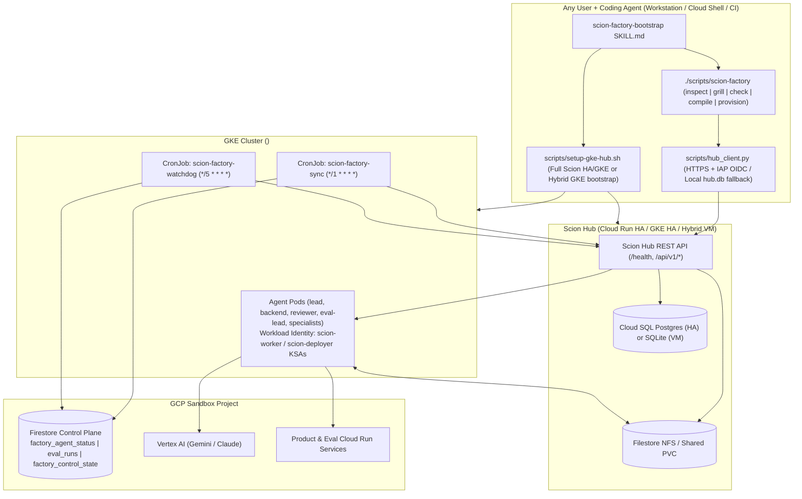

# Universal Auto-Factory & Full GKE Scion Support — Design Specification

**Date:** 2026-10-27  
**Repository:** `duboc/scion-defaults`  
**Status:** Draft for Review

---

## 1. Intent & Problem Statement

`scion-defaults` lets any developer or team pair with an agentic coding assistant (Antigravity, Claude Code, OpenCode, Codex) to inspect a target repository, run a structured Socratic interview grounded in production lessons (`L1`–`L31`), compile a bespoke multi-agent factory kit, and stand up an autonomous build + evaluation software factory on [Scion](https://github.com/GoogleCloudPlatform/scion).

Today, two structural limitations prevent `scion-defaults` from acting as a universal auto-factory toolkit for **any** new or existing Scion installation:

1. **Single-VM + Docker + Local SQLite Coupling:**
   Every operational script (`scion-admin.py`, `push-templates.py`, `hub-preflight.py`, `factory-watchdog.py`, `sync-factory-agents.py`, `make-factory-harness-configs.py`) assumes Scion runs on a single GCE VM with Docker containers, `~/.scion/hub.db` SQLite on local disk, `~/.scion/hub.env` HS256 secret signing, host-path `rsync`, and `gcloud compute ssh` (`run-on-hub.sh`). None of these exist on Scion's **Full Multi-Hub HA / GKE installation** (`deploy/terraform/`: Cloud Run or GKE Hub + Cloud SQL Postgres + Filestore NFS + GKE Autopilot agent pods), and Docker assumptions break on **Hybrid VM + GKE** deployments (`gke_target`).
2. **Manual Post-Compile Handoff:**
   `skills/scion-factory-bootstrap/SKILL.md` and `./scripts/scion-factory` stop after `compile` and hand the operator a manual 8-step VM/Docker runbook. There is no deterministic, dry-run-first `provision` command or GKE Hub bootstrapper that an agent can drive end-to-end (with human approval gates) to install Scion on GKE (or attach to an existing Hub) and launch the compiled factory on Kubernetes pods.

### Explicit Scope Ruling
- **Portable toolkit, NOT a resident `auto-factory` Hub project:** `scion-defaults` is run by **anyone** from their coding agent (workstation, CI, or Cloud Shell) to create a new Scion + GKE installation or onboard a repository onto an existing Scion Hub. It does **not** install a permanent meta-project inside Scion.
- **Agents run as Kubernetes Pods on GKE:** First-class support for both upstream Scion Kubernetes tiers:
  1. **Full GKE / HA Scion (`deploy/terraform/`):** Cloud Run Hub (`configurations/hub`) or GKE Hub (`configurations/hub-gke`) + Cloud SQL Postgres + Filestore NFS + GKE Autopilot agent cluster (`configurations/shared-infra`), zero GCE VM, zero Docker daemon.
  2. **Hybrid VM + GKE Tier (`scripts/single-node-vm/deploy.sh` with `gke_target`):** Single-node Hub VM + NFS export dispatching agent pods to an attached GKE cluster (`profile: gke`).
  3. **Legacy Single-VM Docker Fallback:** Existing `hub.db` + `run-on-hub.sh` setups remain 100% backward-compatible.

---

## 2. Goals, Non-Goals, and Anti-Goals

### Goals
1. **Transport-Agnostic Hub API Layer (`scripts/hub_client.py`):** Operate every `scion-defaults` control, template, preflight, sync, and watchdog workflow purely over the Scion Hub HTTPS REST API (`HUB_URL` + `SCION_HUB_TOKEN` or `~/.scion/credentials.json`, plus optional IAP `Proxy-Authorization` / Cloud Run `X-Serverless-Authorization` OIDC tokens), falling back to local `~/.scion/hub.db` + `hub.env` only when `HUB_URL` is unset and `hub.db` exists.
2. **First-Class GKE Agent Runtime & Workload Identity:**
   - Handle Scion's Kubernetes `block` default GCP identity mode cleanly: support both namespace `default` KSA `passthrough` (Terraform HA `<hub>-agent` GSA) and explicit `assign` mode via GKE Workload Identity (`iam.gke.io/gcp-service-account` KSA annotations + `roles/iam.workloadIdentityUser` for `worker-sa` and `deployer-sa`).
   - Handle cold GKE Autopilot `503` timeouts (`ptone/scion#1956`) idempotently on agent create/start by polling agent/pod state rather than blindly re-POSTing duplicate creates.
   - Replace Docker-only watchdog checks (`docker ps`, `docker exec`, host `rsync`, host crontab) with runtime-agnostic Hub API operations (`/api/v1/projects/{id}/agents/{slug}/exec` for hung-subprocess reaping, `/api/v1/projects/{id}/shared-dirs/knowledge-plane/files/...` for knowledge-plane sync, Firestore-backed watchdog state for stateless pods) + optional `kubectl` pod inspection and Kubernetes `CronJob` manifests (`scion-factory-sync` every 1m, `scion-factory-watchdog` every 5m).
3. **Full Scion + GKE Bootstrap & Deterministic Factory Provisioning:**
   - Provide an idempotent GKE Scion Hub bootstrap/helper script (`scripts/setup-gke-hub.sh`, `DRY_RUN=1` supported) wrapping Cloud Build multi-arch harness image builds (`core-base`, `scion-base`, `claude`, `antigravity`, `opencode`, `hermes`), Terraform `shared-infra` + `hub`/`hub-gke` plan/apply gates, post-apply Hub env (`GOOGLE_CLOUD_PROJECT`, `GOOGLE_CLOUD_REGION`), and Workload Identity KSA setup.
   - Add `./scripts/scion-factory provision` (`scripts/provision_factory.py`, dry-run by default, `--apply` to execute) to take a validated `factory.yaml` + compiled kit + `factory.env` and deterministically provision sandbox IAM, branches/waves, Hub projects, project GCP identity & runtime profile settings, shared dirs, initial knowledge-plane sync, monorepo `<harness>-factory` configs, role templates, K8s CronJobs, heartbeat schedules, and `lead` + `eval-lead` pods.
   - Upgrade `skills/scion-factory-bootstrap/SKILL.md`, `README.md`, and `docs/gke-setup-runbook.md` so any coding agent can guide a user from zero (full Scion + GKE install) or an existing Hub to a live GKE agent factory.

### Non-Goals
- Forking or vendoring Scion's Terraform modules (`deploy/terraform/` remains in upstream `GoogleCloudPlatform/scion`; `setup-gke-hub.sh` orchestrates an upstream Scion checkout cleanly).
- Replacing Firestore with Cloud SQL or Spanner for the factory's own control plane (`factory_agent_status` and `eval_runs` stay serverless in Firestore via `scripts/factory_store.py`).

### Anti-Goals (Failure Modes Even If Technically Functional)
- Requiring SSH or a GCE VM anywhere on the GKE / Cloud Run HA path.
- Committing any secret, token (`ghp_*`, `github_pat_*`, `scion_pat_*`), email, or real GCP project/cluster/VM identifier into tracked files.
- Silently mutating GCP, Terraform, GitHub, or Hub state without a `DRY_RUN=1` / `--dry-run` plan step.
- Blindly retrying `POST /agents` on HTTP `503` during a GKE Autopilot cold node scale-up.

---

## 3. Upstream Scion GKE & Hub API Contracts (Verified Against `GoogleCloudPlatform/scion`)

### 3.1 Hub Authentication & IAP Transport (`pkg/credentials`, `pkg/transportauth`)
- **Hub Bearer Token (`Authorization: Bearer <token>`):**
  1. `SCION_HUB_TOKEN` environment variable (explicit token or CI/K8s Secret).
  2. `~/.scion/credentials.json` (`hubs[<normalized_url>].accessToken`, written by `scion hub auth login`).
  3. Local VM fallback: `HS256` user JWT minted from `~/.scion/hub.db` + `SCION_SERVER_SESSION_SECRET` in `~/.scion/hub.env` when targeting loopback `HUB_LOCAL_URL`.
- **IAP / Cloud Run Transport Token (when Hub sits behind Google IAP or Cloud Run IAM):**
  - When `HUB_IAP_AUDIENCE` (or `SCION_TRANSPORT_AUDIENCE`) is set, attach a Google OIDC ID token for that audience in **`Proxy-Authorization: Bearer <oidc>`** (Google IAP strips `Proxy-Authorization` after verification and forwards `Authorization: Bearer <scion-hub-token>` intact to Scion Hub).
  - When `HUB_TRANSPORT_MODE=serverless`, attach **`X-Serverless-Authorization: Bearer <oidc>`**.
  - OIDC token sources: GCE/GKE metadata server (`/computeMetadata/v1/instance/service-accounts/default/identity?audience=...&format=full`) when running on GCP/GKE with Workload Identity, else `gcloud auth print-identity-token --audiences=...` (or `HUB_TRANSPORT_TOKEN` if pre-injected).

### 3.2 Health Endpoint on Cloud Run (`agent-runbook-terraform-ha.md` §8.2)
- Cloud Run reserves `/healthz` at the platform edge and returns `404`; Scion aliases its health handler to `/health`.
- `HubClient.health()` MUST probe `GET /health` first and fall back to `GET /healthz`.

### 3.3 Hub REST Endpoints Replacing Direct `hub.db` Queries
| Operation | Previous (`hub.db` / SSH) | Transport-Agnostic Hub API (`HubClient`) |
|---|---|---|
| Health & version | `curl localhost:8080/healthz` | `GET /health` (fallback `GET /healthz`) |
| Admin / PO user lookup | `SELECT id, email, role FROM users` | `GET /api/v1/auth/me` + `GET /api/v1/users?search=<PO_EMAIL>` |
| Projects list / lookup / create | `SELECT id, slug FROM projects` + `.scion/project-id` file | `GET /api/v1/projects`, `POST /api/v1/projects`, `GET /api/v1/projects/{id}` |
| Project runtime profile & GCP identity | N/A (manual CLI) | `GET/PUT /api/v1/projects/{id}/settings` (`activeProfile`, `defaultGCPIdentityMode`, `defaultGCPIdentityServiceAccountID`, `defaultGCPIdentityServiceAccountIDByProfile`) |
| Project GCP service accounts | `scion project service-accounts` on VM | `GET/POST /api/v1/projects/{id}/gcp-service-accounts`, `POST /api/v1/gcp-service-accounts/{saId}/verify` |
| Templates & `L16` storage isolation | `SELECT storage_path, storage_uri, files FROM templates` | `GET /api/v1/templates?scope=project&projectId={id}` (`storagePath`, `storageUri`, `files`, `contentHash`) + `POST /api/v1/templates`, `/upload`, `/finalize`, `PATCH` |
| Global `<harness>-factory` configs | Local `~/.scion/harness-configs` on VM | `GET /api/v1/harness-configs?scope=global`, `/download-urls` (or local `~/.scion/harness-configs`), `POST /api/v1/harness-configs`, `/upload`, `/finalize` |
| Agents list, start, message, exec | `SELECT ... FROM agents` + `docker ps` + `docker exec` | `GET /api/v1/projects/{id}/agents`, `POST .../agents` / `POST .../start` (with cold-start `503` poll), `POST .../message`, `POST .../exec` (`{"command": [...], "timeout": 10}`) |
| Schedules guard | `SELECT ... FROM schedules` + SQLite `UPDATE` | `GET /api/v1/projects/{id}/schedules`, `POST .../schedules`, `PATCH`, `POST .../pause`, `POST .../resume` |
| PO Inbox escalations | `SELECT ... FROM messages WHERE recipient=...` | `GET /api/v1/messages?limit=100` (filtering `type != "state-change"` and `created > last_user_msg_ts`) |
| Shared `knowledge-plane` sync | Host `rsync` into `~/.scion/project-configs/...` | `GET /api/v1/projects/{id}/shared-dirs/knowledge-plane/files`, `PUT .../files/{relPath}`, `DELETE .../files/{relPath}` (with local `rsync` fallback when host/NFS dir is mounted) |

### 3.4 GKE GCP Identity & Workload Identity Model (`start_context.go` & `agent-runtime-k8s`)
On Kubernetes runtimes, Scion defaults new agents to **`block`** (metadata server intercepted, API token unmounted). Scion never creates or binds Kubernetes ServiceAccounts (KSAs) itself. Two clean patterns work out of the box:
1. **Worker Agents (`lead`, `backend`, `reviewer`, `eval-lead`, specialists):**
   - **Option A — Dedicated `worker-sa` (`assign` mode, works identically on BOTH Terraform HA and Hybrid GKE):**
     - `setup-sandbox.sh` creates `<WORKER_SA_NAME>@<SANDBOX_PROJECT>.iam.gserviceaccount.com` (`roles/aiplatform.user`, `roles/datastore.user`, `roles/serviceusage.serviceUsageConsumer`, `roles/storage.objectAdmin` on `$DATA_BUCKET`).
     - In `<HUB_K8S_NAMESPACE>` (on `<HUB_PROJECT>`), KSA `scion-worker` is created and annotated `iam.gke.io/gcp-service-account=<WORKER_SA_EMAIL>`, and IAM grants `roles/iam.workloadIdentityUser` to `serviceAccount:<HUB_PROJECT>.svc.id.goog[<HUB_K8S_NAMESPACE>/scion-worker]`.
     - Scion's Kubernetes runtime automatically discovers the single KSA in `<HUB_K8S_NAMESPACE>` carrying `iam.gke.io/gcp-service-account=<WORKER_SA_EMAIL>` (or uses `kubernetes_service_account_mappings`), registers `<WORKER_SA_EMAIL>` in the project (`POST /api/v1/projects/{id}/gcp-service-accounts`), and sets the project default GCP identity (`PUT /api/v1/projects/{id}/settings` -> `defaultGCPIdentityMode: "assign"`, `defaultGCPIdentityServiceAccountID: <sa_id>`).
   - **Option B — Terraform HA Ambient `<hub>-agent` (`passthrough` mode):**
     - When `SANDBOX_PROJECT == HUB_PROJECT` on Terraform HA, `agent-runtime-k8s` already binds `<HUB_K8S_NAMESPACE>/default` KSA to `<hub>-agent@<project>.iam.gserviceaccount.com` (`roles/aiplatform.user`). Granting `datastore.user` + `serviceUsageConsumer` to `<hub>-agent` and setting `defaultGCPIdentityMode: "passthrough"` works with zero extra KSAs.
   - Our tooling supports **both**: `WORKER_SA_NAME` (default `agent-worker` on GKE) uses explicit `assign` + `scion-worker` KSA (works even when `SANDBOX_PROJECT != HUB_PROJECT` and on Hybrid GKE!), while `GCP_IDENTITY_DEFAULT=passthrough` remains selectable for single-project Terraform HA.
2. **Deployer Agents (`deployer`, `eval-deployer` when `infrastructure.deploy: service`):**
   - `setup-sandbox.sh` creates `<DEPLOYER_SA_NAME>@<SANDBOX_PROJECT>.iam.gserviceaccount.com` and, when `HUB_K8S_NAMESPACE` is set, binds Workload Identity (`serviceAccount:<HUB_PROJECT>.svc.id.goog[<HUB_K8S_NAMESPACE>/scion-deployer]`) and creates/annotates KSA `scion-deployer` in `<HUB_K8S_NAMESPACE>`.
   - `provision` registers `<DEPLOYER_SA_EMAIL>` in the Scion project so `lead` / `eval-lead` start `deployer` / `eval-deployer` with `--service-account <DEPLOYER_SA_EMAIL>`.

---

## 4. Architecture & Component Design

### 4.1 New & Updated Configuration Keys (`config/factory.env.example` & Compiled Kits)
All new keys are optional and preserve 100% compatibility with existing `factory.env` files:
- `HUB_URL` — Public/internal HTTPS URL of the Scion Hub (e.g. `https://hub.example.com` or Cloud Run URI). When set, all scripts talk directly over HTTPS without `run-on-hub.sh` or `hub.db`.
- `HUB_IAP_AUDIENCE` — Optional IAP OAuth Client ID audience; attaches `Proxy-Authorization: Bearer <oidc>`.
- `HUB_TRANSPORT_MODE` — `iap` (default when `HUB_IAP_AUDIENCE` set) or `serverless` (`X-Serverless-Authorization`).
- `AGENT_RUNTIME` — `kubernetes` (default for GKE setups) or `docker` (legacy single-VM).
- `RUNTIME_PROFILE` — Optional Scion broker profile name (e.g. `gke` on Hybrid VM+GKE; empty on pure Terraform HA where Kubernetes is the sole runtime).
- `HUB_GKE_CLUSTER` / `HUB_GKE_LOCATION` / `HUB_K8S_NAMESPACE` — GKE cluster coordinates and agent pod namespace (`<hub_name>` on Terraform HA, `scion-hub-<hub_name>` on Hybrid GKE).
- `IMAGE_REGISTRY` — Artifact Registry prefix (`<region>-docker.pkg.dev/<project>/<repo>`) for GKE harness images.
- `WORKER_SA_NAME` — Sandbox GCP service account for non-deployer GKE pods (`default: agent-worker` when `AGENT_RUNTIME=kubernetes`).
- `HUB_SA` — Hub runtime GCP service account email (replaces `HUB_VM` lookup when running on Cloud Run / GKE).

### 4.2 `FactorySpec` Extensions (`scripts/scion_factory.py` & `config/factory.schema.json`)
Under `infrastructure`:
- `runtime`: `"kubernetes"` | `"docker"` (optional; existing specs omitting `runtime` remain 100% valid, while `draft_spec_from_repo` and GKE workflows support `"kubernetes"` as first-class).
- `runtime_profile`: optional string (e.g. `""` on pure Terraform HA where Kubernetes is the sole broker runtime, or `"gke"` on Hybrid VM+GKE).
- `worker_sa_name`: optional string (default `"agent-worker"` when `runtime == "kubernetes"`).
- Compiled `config/factory.env.example` retains every existing variable key (with `HUB_URL=` empty by default so legacy tests copying `factory.env.example` stay in local mode unless `HUB_URL` is populated) while adding `AGENT_RUNTIME`, `RUNTIME_PROFILE`, `HUB_K8S_NAMESPACE`, `HUB_GKE_CLUSTER`, `HUB_GKE_LOCATION`, `IMAGE_REGISTRY`, `WORKER_SA_NAME`, and `HUB_SA`.

### 4.3 Stateless Watchdog Bookmark Persistence in Firestore (`scripts/factory_store.py` + `scripts/factory-watchdog.py`)
In a Kubernetes `CronJob`, each 5-minute pod starts with an ephemeral root filesystem unless a volume is mounted. Storing watchdog state (`restarts`, `alerted`, `last_user_msg_ts`) in Firestore collection `factory_control_state` (document `watchdog__<hub_slug_or_default>`, when `FIRESTORE_PROJECT` is configured and `WATCHDOG_STATE_BACKEND=firestore` or in K8s mode, with local file fallback) keeps K8s CronJobs 100% stateless and PVC-free!

### 4.4 Full GKE Hub Bootstrapper (`scripts/setup-gke-hub.sh`) & In-Cluster Cron Installer (`scripts/install-k8s-control-plane.py`)
1. `scripts/setup-gke-hub.sh` (`DRY_RUN=1` supported, `set -euo pipefail`, `CLOUDSDK_CORE_DISABLE_PROMPTS=1`):
   - Validates tools (`gcloud`, `terraform`, `kubectl`, `scion`, `python3`, `jq`) and GCP APIs (`container`, `run`, `file`, `sqladmin`, `secretmanager`, `artifactregistry`, `cloudbuild`, `iap`, `aiplatform`, `iam`, `iamcredentials`).
   - Supports `--tier terraform-ha` (default: clones/uses upstream Scion at `--scion-repo`, builds multi-arch `core-base`, `scion-base`, and requested harness images via Cloud Build into Artifact Registry with immutable tags, renders `shared-infra` and `hub` / `hub-gke` `.tfvars` into git-ignored scratch/work dir, runs `terraform init` + `terraform plan` and stops for human `--approve-apply` before `terraform apply`, sets Hub env `GOOGLE_CLOUD_PROJECT` & `GOOGLE_CLOUD_REGION`, and configures GKE Workload Identity KSAs) and `--tier hybrid-gke` (generates `deploy-config.json` with `gke_target` and `container_images.source=registry`, runs `deploy.sh`, and configures Workload Identity KSAs).
2. `scripts/install-k8s-control-plane.py` (`--dry-run` default, `--apply` to `kubectl apply`):
   - Renders deterministic Kubernetes YAML manifests (`Namespace` if separate or `<HUB_K8S_NAMESPACE>`, `ServiceAccount` `scion-factory-control` annotated with Workload Identity, `ConfigMap` bundling `hub_client.py` + `factory_store.py` + `sync-factory-agents.py` + `factory-watchdog.py`, `Secret` with `SCION_HUB_TOKEN`, 1-minute `CronJob` `scion-factory-sync`, and 5-minute `CronJob` `scion-factory-watchdog`).

### 4.5 End-to-End Provisioner (`scripts/provision_factory.py` + `./scripts/scion-factory provision`)
`./scripts/scion-factory provision <spec_path> --kit <kit_dir> --env <env_file> [--seed-repo <repo_dir>] [--apply] [--json]`:
- Runs a deterministic 9-phase pipeline (printing every planned API/CLI action in dry-run mode when `--apply` is omitted):
  1. **Preflight** (`hub-preflight.py` via `HubClient` + GKE / Artifact Registry checks; computes merged `FACTORY_PROJECTS`).
  2. **Sandbox & Workload Identity** (`setup-sandbox.sh`, including `worker-sa` & `deployer-sa` KSA bindings on GKE).
  3. **Repo Seeding (optional `--seed-repo`):** Merges `knowledge-plane/`, creates orphan `EVAL_BRANCH` with `eval-workspace/`, and seeds Wave 1 GitHub issues (`seed-github-waves.sh`).
  4. **Hub Projects:** Creates `BUILD_PROJECT` and `EVAL_PROJECT` via `HubClient` (handling write-timeout clone wait via `GET /api/v1/projects`).
  5. **Project Identity & Profile Settings:** Registers `worker-sa` and (when `deploy: service`) `deployer-sa` in each project (`POST /api/v1/projects/{id}/gcp-service-accounts`), sets `activeProfile` (`RUNTIME_PROFILE`) and `defaultGCPIdentityMode` / `defaultGCPIdentityServiceAccountID` (`PUT /api/v1/projects/{id}/settings`).
  6. **Shared Dirs & Initial Knowledge-Plane Sync:** Creates `scratchpad` + `knowledge-plane:ro` and uploads `knowledge-plane/` files over the Hub Shared-Dirs Files API so the very first GKE pod sees `/scion-volumes/knowledge-plane` populated!
  7. **Harness Configs & Templates:** Publishes `<harness>-factory` global configs if `monorepo.subdir` is set, then pushes all build & eval role templates via `push-templates.py` direct API mode.
  8. **Control-Plane Loops:** Installs/updates K8s CronJobs (`install-k8s-control-plane.py`) when `AGENT_RUNTIME=kubernetes` (or VM cron when `docker`) with the merged `FACTORY_PROJECTS`.
  9. **Schedules & Lead Pod Launch:** Creates/updates `<BUILD_PROJECT>-lead-heartbeat` (and optional `eval-sweep` schedule), starts `<prefix>lead` and `<prefix>eval-lead` via `HubClient` with cold-Autopilot `503` safe polling, and optionally sends the initial `GO` brief when `--go` is passed.

---

## 5. Builder Decisions & Constraints

- **Zero External Python Dependencies in Runtime Scripts:** `hub_client.py`, `factory_store.py`, `sync-factory-agents.py`, `factory-watchdog.py`, `scion-admin.py`, `push-templates.py`, `hub-preflight.py`, `install-k8s-control-plane.py`, and `provision_factory.py` use **Python 3.10+ stdlib only** (`urllib.request`, `json`, `hashlib`, `subprocess`, `tarfile`), so K8s CronJob pods can run on lightweight `python:3.12-slim` or `google/cloud-sdk:slim` images with zero `pip install` step!
- **Strict Backward Compatibility:** Every existing CLI flag and unit test in `tests/` (`320 passed`) continues to pass unchanged; local `hub.db` mode remains automatic whenever `HUB_URL` is unset.
- **Security & Hygiene (`AGENTS.md`):** Zero real project IDs, cluster names, VM names, emails, or tokens in any tracked file; every shell script uses `set -euo pipefail`, `CLOUDSDK_CORE_DISABLE_PROMPTS=1`, and `DRY_RUN=1` / `--dry-run`.
