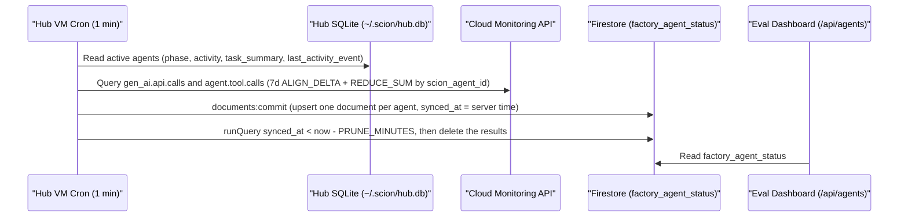

# How Telemetry and Evaluation Data Reach the Eval Dashboard

The evaluation dashboard (Cloud Run) reads two Firestore collections. Firestore is serverless. The factory does not
use Cloud Spanner.

1. **`factory_agent_status`**: live agent state, activity, turn counts, and model call counts.
2. **`eval_runs`**: evaluation results for the L1–L5 pyramid, the quality metrics, and the latency percentiles.

The data contract is in [`config/firestore/README.md`](../../config/firestore/README.md). The security rules deny all
client SDK requests. The Hub sync, the evaluation agents, and the dashboard use IAM service accounts.

---

## Pipeline 1: Live Agent State and Telemetry Sync (`factory_agent_status`)

The Hub VM runs [`scripts/sync-factory-agents.py`](../../scripts/sync-factory-agents.py) every minute from the
`scion` user crontab. The script uses [`scripts/factory_store.py`](../../scripts/factory_store.py) to call the
Firestore REST API.

### How `sync-factory-agents.py` Works



1. **The script reads the Hub state.**
   It opens `~/.scion/hub.db` in read-only mode (`mode=ro`). It selects all agents that are not deleted in the
   factory projects (`FACTORY_PROJECTS`).
2. **The script reads the Cloud Monitoring counters.**
   It queries the Cloud Monitoring API with `ALIGN_DELTA` and `REDUCE_SUM`, grouped by `metric.label.scion_agent_id`:
   - `workload.googleapis.com/gen_ai.api.calls` gives `model_calls`.
   - `workload.googleapis.com/agent.tool.calls` gives `current_turns`.
   - A counter of 0 is written as null. Null means "unknown". It does not mean zero (L9).
3. **The script writes to Firestore.**
   It sends `documents:commit` requests to `FIRESTORE_DATABASE` in `FIRESTORE_PROJECT`. It sends the
   `x-goog-user-project` header with `BILLING_PROJECT` (L12).
   - It upserts one document for each live agent. The document ID is `<project_slug>__<agent_name>`.
   - It deletes the documents that it did not refresh in the last `PRUNE_MINUTES` (10 minutes).

### How to Install or Update the Agent Sync Cron

Run these commands from the repository root:

1. Create the Firestore database and the composite indexes if they do not exist:
   ```bash
   DRY_RUN=1 ./scripts/setup-sandbox.sh
   ./scripts/setup-sandbox.sh
   ```
2. Install the 1-minute cron job on the Hub VM. The job also runs one sync immediately:
   ```bash
   ./scripts/install-sync-cron.sh --dry-run
   ./scripts/install-sync-cron.sh
   ```
3. Check the sync log on the Hub VM:
   ```bash
   ./scripts/run-on-hub.sh bash -c 'tail -n 20 ~/.scion/factory-sync.log'
   ```
4. Read the documents from your workstation:
   ```bash
   python3 scripts/factory_store.py --project "$FIRESTORE_PROJECT" list-agents --project-slug "$BUILD_PROJECT"
   ```

---

## Pipeline 2: Product Evaluation Runs (`eval_runs`)

The evaluation agents test the live product across the 5-layer evaluation pyramid
([`verification-and-eval.md`](../verification-and-eval.md)):

1. **Probes.**
   The evaluation agents send golden requests to the live serving URL.
2. **Metric calculation.**
   The agents calculate:
   - The primary and secondary quality metrics (for the search reference product: `ndcg_at_10` and `mrr_at_10`)
   - The latency percentiles: `p50_ms`, `p95_ms`, and `p99_ms`
   - One result for each requirement, in `requirements`
3. **Persistence in Firestore.**
   The agents write the run as one JSON object. Then they record it:
   ```bash
   python3 /workspace/tools/factory_store.py put-eval-run --file run.json
   ```
   The tool validates the required fields. It writes one document to `eval_runs`. The document ID is the `run_id`. The
   `source` field records the commit SHA (or the snapshot SHA-256) of the tested service. A run that did not occur gets
   no document.
4. **Dashboard API endpoints.**
   - `GET /api/eval` returns the latest evaluation run, the requirement checks, and the latency breakdown.
   - `GET /api/agents` reads `factory_agent_status` and returns the live status of all agents.
